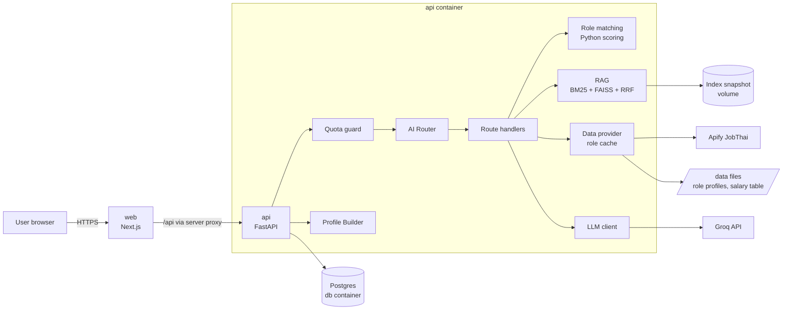
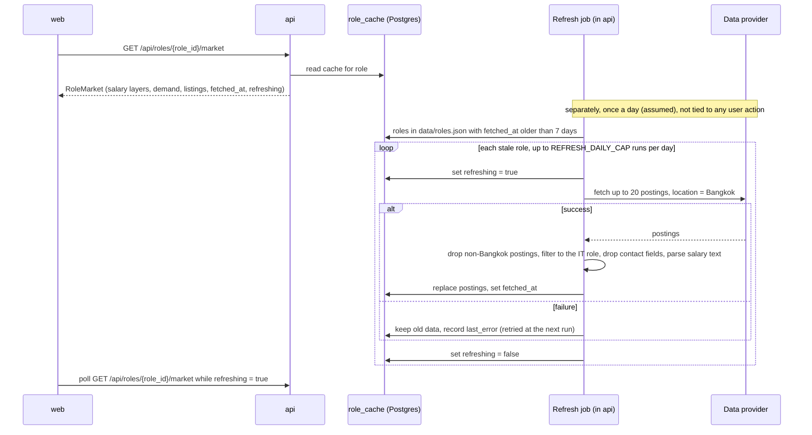

# CareerMirror: Design

<!--
PURPOSE: Architecture and flow only. How the system is put together and how data moves through it.
This file also replaces a separate architecture.md (they would duplicate each other).
DOES NOT CONTAIN: requirements (see PRD.md), UI rules (see DesignSystem.md), colours, fonts (see CIBrand.md),
endpoint shapes (see Contract.md), dates (see Schedule.md). Link to those; do not copy them.
OWNER: backend lead. Update when a component or data flow changes.
-->

Scope and requirements: [PRD.md](PRD.md) · Endpoints: [Contract.md](Contract.md) · UI: [DesignSystem.md](DesignSystem.md)

Status: agreed 1 Nov 2026. Thresholds and scoring weights are decided and are re-checked in the 3 Nov calibration (section 10). The few items still marked (assumed) are not confirmed yet.

## 1. System overview



Three containers: `web`, `api` and `db` (Postgres). Everything else runs inside `api`. The vector index is the hybrid retrieval from Team-D-II module 05 (BM25 + FAISS + Reciprocal Rank Fusion), stored in SQLite with an in-memory snapshot, so no separate vector-DB container is needed. Numbers (match %, completeness %, salary figures) are always computed or looked up in Python; the LLM only writes explanations (PRD FR-18a).

## 2. Components

| component | responsibility | inputs | outputs |
|---|---|---|---|
| **Web** (Next.js App Router, TypeScript) | Thai UI in light and dark theme (choice kept in the browser only, PRD FR-36 to FR-39), consent, CV upload, questionnaire, chat with completeness sidebar, profile, role results, role view | user actions | calls to `/api/*` through the Next.js server proxy (the auth cookie never leaves the server side) |
| **API** (FastAPI) | trust boundary: auth, validation, quota, persistence, orchestration | HTTP requests | JSON per [Contract.md](Contract.md) |
| **Auth** | email + password register/login; JWT (HS256) in an httpOnly cookie | credentials | `user_id` for every request |
| **Quota guard** | per-user daily request and token limit, checked before any LLM call (FR-23, FR-24) | `user_id`, estimated tokens | allow, or `429 QUOTA_EXCEEDED` with reset time |
| **CV parser** | PDF → text → structured fields (skills, education, experience) (FR-1–FR-4) | PDF ≤ 5 MB | draft `CvParsed` for the user to confirm |
| **Profile Builder** | completeness meter (FR-9, FR-14), "Generate profile" (FR-15–FR-17), profile edits (FR-27–FR-34) | CV, answers, chat facts | `Profile` with evidence per claim |
| **AI Router** | picks exactly one route per chat message (FR-11), logs the decision (FR-13) | message + short context | `route`, `confidence`, `layer` |
| **Role matching** | match % per role, matched / missing skills, threshold, top N, gaps (FR-18–FR-20a) | profile, role profiles | `RoleMatch[]` |
| **RAG** | hybrid search over role descriptions, learning paths, soft-skill and work-style notes | query, filters | chunks with source ids |
| **Data provider** | job postings, advertised salaries, demand per role behind one interface; per-role cache, Bangkok only, refreshed by a scheduled job (FR-21–FR-22f) | `role_id` | `RoleMarket` with `fetched_at` |
| **LLM client** | Groq chat completions, model per task from env (section 4.7), retry with backoff, fallback model on 429/413, token counting | prompt | text or structured JSON, tokens used |
| **Admin** | read-only monitoring for `ADMIN_EMAILS` accounts (PRD FR-40 – FR-46): health, LLM usage, quota, job-data cache, router, funnel | admin `user_id` | aggregates from the tables in section 5, never user content |
| **Request and LLM logging** | middleware writes one `request_log` row per API request; the LLM client writes one `llm_calls` row per Groq call (every task, not only chat) | request, LLM call | rows for the admin dashboard |
| **Storage** | Postgres in the `db` container (app data); SQLite file on the `api` volume (RAG retrieval store only) | – | – |

Reused code (read before writing new): Team-D-II `services/02_api_backend` (app factory, Problem-JSON errors, request-id middleware, body guard, rate limit, JWT cookie auth, Alembic) and `services/05_retrieval_knowledge` (SQLite store, chunking, hybrid search, snapshot swap). Retrieval moves from its own service into `api/app/rag/`.

### 2.1 API code layout

```
api/app/
  main.py               app factory, lifespan (open DB, load index snapshot)
  core/                 config, errors (Problem-JSON), logging, security (JWT, password hash)
  api/routes/           auth, me, cv, questionnaire, chat, profile, roles, quota, admin
  services/             use cases: profile_builder, chat_service, quota_service, edit_service, admin_stats
  domain/               pure Python, no FastAPI or DB imports
    matching/           skills.py (taxonomy + aliases) · scoring.py · models.py
    completeness.py · evidence.py · edits.py
  router/               guards, rules, LLM decision, route handlers, prompts
  rag/                  store, chunking, tokenize (pythainlp), embedder, snapshot, hybrid
  providers/            data provider interface, apify_jobthai, reference_table, nso
  infra/                db session + models, migrations glue, llm client
api/tests/              mirrors app/
```

`domain/` stays framework-free so scoring and edit validation are unit-tested without a server.

## 3. Request flow (chat message)

1. `web` sends the message to `POST /api/chat` with the auth cookie.
2. `api` authenticates, validates the body, assigns `request_id`.
3. **Quota guard**: if the user's requests or tokens for today are used up → `429 QUOTA_EXCEEDED`; no LLM call (FR-24).
4. **AI Router** decides the route (section 4.6). Rules and guards cost no tokens; the LLM layer counts toward quota.
5. The route handler fetches only what it needs: profile slices, scoring results, RAG chunks, cached market data (FR-12).
6. The LLM writes the answer from that context. Numbers in the answer must match the computed values; a check rejects mismatches and falls back to a template.
7. `api` records tokens used, logs `request_id`, route, layer, latency and tokens (never CV text), stores the chat message.
8. Response returns the answer, cited sources, any profile-edit proposal, and quota headers.

## 4. Main flows

### 4.1 Intake: CV, questionnaire, chat, completeness

```mermaid
sequenceDiagram
  participant W as web
  participant A as api
  participant DB as Postgres
  W->>A: POST /api/cv (PDF)
  A->>A: check type and size, extract text (pypdf / pdfplumber)
  alt no text layer (scanned)
    A-->>W: 422 CV_UNREADABLE (Thai message)
  else text found
    A->>A: extract skills, education, experience (rules + skill taxonomy; plus LLM extraction if quota is left, counted toward quota; rules only otherwise)
    A->>DB: save draft (status = draft)
    A-->>W: CvParsed draft
    W->>A: PUT /api/cv/confirm (user-corrected fields)
    A->>DB: save confirmed fields, recompute completeness
  end
  W->>A: PUT /api/questionnaire/answers/{question_id}
  A->>DB: upsert answer (resume later, FR-6)
  W->>A: POST /api/chat (follow-up answers)
  A->>DB: store extracted facts with evidence
  W->>A: GET /api/profile/completeness
  A-->>W: score 0-100, missing slots, can_generate
```

The raw PDF is not stored; only the extracted text (needed as evidence lines) and the confirmed fields. CV text is never written to logs.

**Completeness meter** (decided 1 Nov 2026, PRD open question 3; weights and threshold calibrated on 3 Nov). Slot weights follow what the outputs use: hard skills with levels drive 85% of the match % (section 4.3) and all next steps, so they weigh most and are required; goals and education are not used in scoring.

| slot | points | required | filled by |
|---|---|---|---|
| hard skills (≥ 3, each with a level) | 35 | yes | CV, questionnaire checklist or chat |
| experience entries, or "no experience" stated | 15 | yes | CV or chat |
| soft skills (≥ 3 with an example) | 15 | no | questionnaire or chat |
| goals: interested roles, desired salary, location | 15 | no | questionnaire or chat |
| work-style preferences | 10 | no | questionnaire or chat |
| education | 10 | no | CV or chat |

```
can_generate = (CV confirmed or questionnaire answered)
               and every required slot is filled
               and score ≥ COMPLETENESS_THRESHOLD (65)
```

- 65 = the two required slots (50) plus at least one more slot.
- Skill level for CV users comes from rules (years, project count). When the CV gives neither, chat asks the user for a self-rating (1-5). The questionnaire checklist already asks for a level.
- `gap_question` asks about missing required slots first, then the slot with the most points.
- Expected chat turns before generation: questionnaire-only student 1 (experience), CV-only developer 1 (soft skills or goals), CV + questionnaire 0.

### 4.2 Generate profile

```mermaid
sequenceDiagram
  participant W as web
  participant A as api
  participant L as Groq
  W->>A: POST /api/profile/generate
  A->>A: can_generate? quota check
  A->>A: build facts list with evidence ids (CV lines, answers, chat statements)
  A->>A: map free-text skills to taxonomy (aliases, then embedding similarity)
  A->>L: summarise sections from facts only (structured JSON, each claim lists evidence ids)
  L-->>A: draft sections
  A->>A: drop claims without valid evidence ids; drop removed skills
  A->>A: save Profile, run role matching (4.3)
  A-->>W: Profile + RoleMatch summary
```

Profile sections: hard skills, soft skills, work-style preferences (shown as self-reported, FR-17), experience summary, blind spots. Skill levels come from rules (years, project count, self-rating), not from the LLM.

### 4.3 Role matching, threshold, next steps

For each of the 26 role profiles in `/data/roles/`:

```
hard_required = Σ w·min(user_level / min_level, 1) / Σ w      # missing skill = 0; any_of group = user's best level in the group
hard_nice     = share of nice-to-have hard skills the user has
soft          = share of the role's soft skills present in the profile
work_style    = 1 − mean distance between user preferences and role traits (0..1)

match_pct = round(100 × (0.70·hard_required + 0.15·hard_nice + 0.10·soft + 0.05·work_style))
```

Weights decided 1 Nov 2026 and re-checked in the 3 Nov calibration (section 10).

- Removed skills are excluded (FR-31). Skills are compared by taxonomy id after alias normalisation (Thai and English names).
- Show roles with `match_pct ≥ MATCH_THRESHOLD` (60), top `TOP_N_ROLES` = 5 (FR-19, FR-20). The threshold is re-checked with three sample profiles (student, full-stack developer, ML developer) on 3 Nov.
- None pass → return the 3 closest roles with `below_threshold = true` and their missing skills (FR-19a).
- **Gaps** per role = missing required skills (sorted by weight) + below-level skills + missing soft skills. Each gap has an id.
- **Next steps** (FR-20a): the LLM receives the gap list plus RAG learning-path chunks for that role and writes up to 5 prioritised actions; each action must reference one gap id. Actions without a valid gap id are dropped.
- Match reasons cite evidence ids for matched skills (FR-16, FR-19).
- Matching never triggers a fetch. Role views read the shared per-role cache (FR-22b, 4.4).

### 4.4 Role view: cache read, scheduled refresh, fallback



- Reading a role view always uses the cache and never calls the provider (FR-22b). User actions (matching, opening a role, editing the profile) never trigger a fetch.
- The cache is one copy per role, shared by all users (FR-22a).
- Seed run before the demo: one fetch per role, stored as the baseline in the `db-data` volume, not in git (FR-22a).
- Refresh rules (FR-22b, FR-22c, FR-22f):
  - every role in `data/roles.json` (currently 26) is refreshed when its cache is older than `CACHE_MAX_AGE_DAYS` (7);
  - each run asks for up to 20 postings with the Bangkok location filter, so a full cycle is 26 runs and about 520 results per week;
  - `REFRESH_DAILY_CAP` (20) limits provider runs per day as a safety cap; roles left over run the next day (assumed);
  - the job runs inside `api`, started from the app lifespan, and checks once a day for stale roles. Because `api` has one worker, only one copy of the job runs (assumed).
- On failure the view shows the previous cached data with its date (FR-22b, NFR reliability). `refreshing` is true only while that role is being fetched, so the loading state is shown only then (FR-22d).

### 4.5 Profile edit (chat edit and remove button)

```mermaid
sequenceDiagram
  participant W as web
  participant A as api
  participant L as Groq
  W->>A: POST /api/chat "เปลี่ยนสายงานที่อยากได้เป็น Data Engineer"
  A->>A: quota check, router → profile_edit
  A->>L: extract structured change (field, op, new value)
  L-->>A: change
  A->>A: validate against allow-list; fill old value from stored profile
  A-->>W: proposal (Thai text of the exact change) + edit_id
  W->>A: POST /api/profile/edits/{edit_id}/confirm
  A->>A: apply, label edited_by_user, evidence = user_statement
  A->>A: recompute matching (role views re-read the cache, no fetch)
  A-->>W: updated Profile + RoleMatch
  Note over W,A: Remove button: DELETE /api/profile/skills/{skill_id}<br/>no LLM, no quota; adds skill to removed list; recompute
```

- Skill removal asks for confirmation in the UI before `DELETE` is sent (FR-29, PRD open question 7); there is no undo toast. Restore is from the removed list.
- The LLM never writes to the profile (FR-28). Confirm, reject, remove and restore cost no quota and work when quota is exhausted (FR-30, FR-34).
- A removed skill is not re-added from the CV or chat; a chat request to add it back produces a proposal flagged `restores_removed_skill` that the user confirms (FR-31).

### 4.6 AI Router

Layers, reused from Team-D-II module 03:

1. **Guards** (no LLM): empty or too long input, prompt-injection markers, off-topic patterns → `decline`.
2. **Keyword rules** (no LLM): Thai and English patterns per route, confidence 0.9.
3. **LLM decision** (Groq, structured output, counts toward quota) when rules do not match.
4. Low confidence (< 0.6, assumed) → `clarify`.

| route | fetches | LLM writes |
|---|---|---|
| `skill_assessment` | profile hard/soft skills with evidence | assessment text |
| `work_style` | questionnaire work-style answers + RAG work-style notes | description as self-reported preference |
| `blind_spots` | gaps for the user's top roles + RAG soft-skill notes | blind-spot text with evidence |
| `job_matching` | `RoleMatch[]` (computed) + RAG role descriptions | reasons, next steps |
| `salary` | `RoleMarket.salary` from cache (role from message or last picked) | wording of the ranges with source, measure, date |
| `market` | `RoleMarket.demand` and listings from cache | demand summary |
| `experience` | CV experience entries (months computed in Python) | summary |
| `profile_edit` | the targeted field only | structured change (4.5) |
| `clarify` / `decline` | – | one short question / refusal |
| `gap_question` | missing completeness slots | the next follow-up question to fill a gap |

Before a profile exists, most messages route to `gap_question`: chat asks follow-up questions driven by the missing completeness slots (FR-8), and the user's answers become facts with chat evidence. A Thai router evaluation set (about 40 cases, like `eval_routes.py` in Team-D-II) is kept in `api/tests/router/` and its accuracy goes into the report.

### 4.7 LLM models and limits

Decided 1 Nov 2026 (PRD open question 2). Model IDs come from env, so they can change without code changes.

| task | env var | model |
|---|---|---|
| profile generation, match reasons, next steps (user-facing Thai text) | `GROQ_MODEL` | `openai/gpt-oss-120b` |
| router decision, profile-edit extraction, CV extraction, chat follow-up questions | `GROQ_ROUTER_MODEL` | `qwen/qwen3.8-27b` |
| fallback when the main model returns 429 or 413 | `GROQ_FALLBACK_MODEL` | `qwen/qwen3.8-27b` |

Groq limits per model, from the official rate-limits page (Nov 2026; verify for our account at console.groq.com/settings/limits): 30 requests/min, 1,000 requests/day, 8,000 tokens/min, 200,000 tokens/day. Limits apply to the whole Groq account, so every API key on that account shares them.

Rules that follow from the limits:

- The binding limit is 8K tokens/min. Keep each prompt under about 5K tokens: top RAG chunks only, a CV summary instead of the full text.
- On 429: retry once with backoff, then call `GROQ_FALLBACK_MODEL`, then return a Thai error message. On 413: shorten the prompt or go straight to the fallback model.
- Per-user quota (assumed until tested): `QUOTA_DAILY_REQUESTS=40`, `QUOTA_DAILY_TOKENS=40000`. One full run (about 10 chat turns at about 2K tokens plus about 15K tokens for profile and matches) fits, and about 5 users per day fit the 200K tokens/day of the main model.
- Use a separate Groq account for the demo so development and testing do not use up its daily budget.
- No second provider (for example Gemini) as fallback in the MVP: it would need another key and client before 5 Nov.

### 4.8 Admin dashboard

```mermaid
sequenceDiagram
  participant W as web /admin
  participant A as api
  participant DB as Postgres
  W->>A: GET /api/admin/overview?window=today
  A->>A: authenticate; email in ADMIN_EMAILS? else 403 FORBIDDEN
  A->>DB: aggregate request_log, llm_calls, quota_usage, router_log, role_cache, job_postings, refresh_log, user tables
  A-->>W: AdminOverview (counts, rates, per-role cache rows, warnings)
  Note over W: refresh button and auto-refresh every 60 s while the page is open
```

- `ADMIN_EMAILS` is a comma-separated list in `.env` (the two team members). The check runs on every `/api/admin/*` request; there is no admin flag in the database, so changing admins needs only an env change and a restart.
- Read-only (FR-41): admin endpoints only run `SELECT` queries, never call the provider or the LLM, and are not counted in quota.
- Aggregates only (FR-42): queries return counts, rates and per-role rows; no query selects CV text, chat text, answers or emails.
- LLM limits are counted per Asia/Bangkok day from `llm_calls`; Groq's own reset time may differ, so the dashboard is an early warning, not the exact Groq counter (assumed). Limits come from `GROQ_DAILY_TOKEN_LIMIT` and `GROQ_DAILY_REQUEST_LIMIT` (200,000 and 1,000, section 4.7).
- Warnings (FR-44) use `ADMIN_WARN_LLM_PCT` (80), `ADMIN_WARN_ERROR_PCT` (5) and the cache rules in 4.4 (older than `CACHE_MAX_AGE_DAYS`, or `last_error` set); Apify runs this week are compared with the weekly budget of 26 (FR-22c).
- p50 / p95 latency is computed from `llm_calls.latency_ms`; the error rate from `request_log.status` and `code`.
- `request_log` and `llm_calls` keep `LOG_RETENTION_DAYS` (30, assumed); a daily cleanup in the same scheduled job as the cache refresh deletes older rows.

## 5. Data model

Postgres (decided 1 Nov 2026, PRD open question 6), managed with Alembic. All user tables key on `user_id` and are removed by `DELETE /api/me`. JSON columns use `JSONB`. Tests may still run on a temporary SQLite file, so models avoid Postgres-only features outside JSON.

| table | fields |
|---|---|
| `users` | id, email (unique), password_hash, display_name, consent_at, created_at |
| `cv_documents` | id, user_id, filename, text_lines (JSON list), parsed (JSON), status (draft / confirmed), created_at, confirmed_at |
| `answers` | user_id, question_id, value (JSON), updated_at |
| `chat_messages` | id, user_id, role (user / assistant), text, route, request_id, created_at |
| `facts` | id, user_id, kind (skill / experience / education / preference / soft_skill / goal), value (JSON), evidence_id, created_at |
| `evidence` | id, user_id, kind (cv_line / answer / chat / rag_chunk / user_action), ref, excerpt |
| `profiles` | user_id (PK), sections (JSON with claims and evidence ids), profile_version, generated_at, updated_at |
| `removed_skills` | user_id, skill_id, removed_at |
| `edit_proposals` | id, user_id, changes (JSON), status (pending / applied / rejected / expired), created_at, expires_at |
| `quota_usage` | user_id, day (Asia/Bangkok), requests, tokens |
| `router_log` | request_id, user_id, route, layer, confidence, latency_ms, tokens, created_at (no message text) |
| `role_cache` | role_id (PK), fetched_at, refreshing, last_error, demand (JSON), salary_advertised (JSON) |
| `job_postings` | id, role_id, source, title, company, location, salary_text, salary_min, salary_max, salary_period, posted_at, url, fetched_at |
| `refresh_log` | day, role_id, status, created_at (counts runs for `REFRESH_DAILY_CAP`) |
| `request_log` | request_id, user_id (nullable), method, route (path template, e.g. `/api/roles/{role_id}`), status, code, latency_ms, created_at (no body, no query values) |
| `llm_calls` | id, request_id, user_id (nullable), task (route or `profile_generate`, `explain`, `cv_extract`, `edit_extract`), model, prompt_tokens, completion_tokens, latency_ms, outcome (`ok` / `rate_limited` / `too_large` / `timeout` / `error`), fallback_used, created_at (no prompt or answer text) |

The retrieval store (`documents`, `chunks`, `meta`) stays a separate SQLite file owned by `api/app/rag/`, as in Team-D-II module 05: it is rebuilt from `/data` and loaded into memory, so it does not need Postgres.

## 6. Role profiles and RAG documents

Authored files in `/data` (labelled team-curated in the UI):

```
data/
  roles.json                  role list: id, Thai/English name, source files
  roles/<role_id>.json        structured role profile
  roles/<role_id>.md          prose description + learning path (RAG source)
  skills.json                 skill ids, type (hard / soft), category, Thai/English names, aliases, sources
  role-skills.draft.json      first draft of skills per role, used to write the role profiles
  questionnaire.json          question ids, type, options, which slot they fill, source_ids, sources block
  rag/work_style.md           what each work-style preference means at work (to be written)
  rag/soft_skills.md          soft skills in IT roles with observable examples (to be written)
  salary/reference.csv        role_id, min, max, measure, level, match, source, url, file, published_at, retrieved_at, note
                              (18 of 26 roles; sources and duplicate rules in salary/README.md)
```

**Questionnaire sources** (decided 1 Nov 2026, PRD open question 4). Items are written by the team, in Thai, as self-report questions. They are built on O*NET descriptor names and definitions; the O*NET questionnaires themselves are not used, because they ask workers to rate their job, not themselves.

| source_id | source | used for | license |
|---|---|---|---|
| `onet_work_styles` | O*NET OnLine, Browse by Work Styles, USDOL/ETA, <https://www.onetonline.org/find/descriptor/browse/1.D> (retrieved 1 Nov 2026) | the six work-style questions and the adaptability, collaboration, perseverance and attention-to-detail items | CC BY 4.0 |
| `onet_skills` | O*NET OnLine, Browse by Essential Skills <https://www.onetonline.org/find/descriptor/browse/2.A> and Transferable Skills <https://www.onetonline.org/find/descriptor/browse/2.B>, USDOL/ETA (retrieved 1 Nov 2026) | the communication, growth, prioritization, collaboration and analytical-thinking (from Critical Thinking) items | CC BY 4.0 |
| `team` | written by the team | skills checklist, experience, education, motivation, goals, the open example question | – |

Attribution (CC BY 4.0) is required in the report and on the questionnaire page: credit USDOL/ETA, link the licence, and state that the team modified the content and that USDOL/ETA has not endorsed it. The full text is in `sources[].attribution` of `data/questionnaire.json`.

The location question (`go_location`) offers Bangkok, regional, remote and any, but job and salary data are Bangkok only (PRD FR-22f). The answer is stored as a goal and shown in the profile; it does not filter roles, and the role view keeps its "Bangkok data" label.

Every item in `questionnaire.json` lists its `source_ids`; the file's `sources` block holds URL, license, retrieved date and attribution text. The questionnaire page shows the attribution in its footer (DesignSystem.md section 5). Answers map to role profiles through `trait` (work style) and `skill_id` (soft skills), described below.

Role list (decided 1 Nov 2026, PRD open question 5a): the 26 roles in `data/roles.json`, ids in kebab-case (`software-engineer`, `ai-engineer`, ...). Skill ids come from `data/skills.json`. Profiles were drafted from `data/role-skills.draft.json` and the files in `pdf/`; they stay `status: draft` until a teammate reviews them.

Role profile shape (`data/roles/<role_id>.json`):

```json
{
  "role_id": "backend-developer",
  "title_th": "นักพัฒนาแบ็กเอนด์",
  "title_en": "Backend Developer",
  "career_stage": "entry",
  "required": [
    {"any_of": ["python", "java", "nodejs", "php", "dotnet", "ruby"], "min_level": 2, "weight": 3,
     "basis": "source", "evidence": ["pdf/23-fullstack-developer-job-description.pdf"]},
    {"skill_id": "sql", "min_level": 2, "weight": 3, "basis": "common", "evidence": []}
  ],
  "nice_to_have": ["docker", "caching"],
  "soft_skills": ["problem-solving", "teamwork"],
  "work_style": {"teamwork": 0.6, "structure": 0.6, "ambiguity": 0.5, "pressure": 0.5, "innovation": 0.5, "leadership": 0.3},
  "author": "Phanlop Boonleua",
  "reviewer": "Phanlop Boonleua",
  "status": "draft",
  "updated_at": "2026-11-01",
  "sources": [{"file": "pdf/23-...pdf", "url": "...", "language": "en"}]
}
```

- `any_of`: alternatives where knowing one is enough (for example one backend language); scored with the user's best level in the group.
- `weight`: 1-3. `min_level`: the level a junior hire needs (most are 2).
- `basis`: `source` when the skill is stated in the role's source files (listed in `evidence`), `common` when it is common practice but not in the sources yet; confirm `common` skills with Bangkok postings.
- `career_stage`: `entry`, `mid` (it-project-manager, it-consultant) or `senior` (data-architect). Used to tell a fresh graduate why a mid or senior role scores low.
- `work_style` keys are the `trait` values of the six work-style questions in `data/questionnaire.json` (O*NET Work Styles): `teamwork` (solo to always with the team), `structure` (own flexible approach to clear steps and standards), `ambiguity` (wants a clear brief to enjoys open problems), `pressure` (steady planned pace to urgent tight deadlines), `innovation` (proven methods to new methods and tools), `leadership` (own part to leading and coordinating). The role value is 0..1; a user answer of 1-5 becomes (answer − 1) / 4 before the distance is taken.
- `soft_skills` are ids from `data/skills.json`. Each soft-skill question in `data/questionnaire.json` carries a `skill_id` (adaptability → `adaptability`, collaboration → `teamwork`, communication → `communication`, growth → `self-motivation`, prioritization → `time-management`, perseverance → `problem-solving`, attention_to_detail → `attention-to-detail`, analytical_thinking → `analytical-thinking`). An answer of 4 or 5 adds that skill to the profile as self-reported, with the answer as evidence. These eight cover the soft skills most roles list; the rest (for example `organization`, `creativity`, `presentation`) come from the CV or chat.

Role Markdown (`data/roles/<role_id>.md`): front matter (role_id, author, reviewer, status), then `## Role description` (category `role_description`) and `## Learning path` (category `learning_path`), written in Thai, then `## Sources` (not indexed). The learning path lists the required skills in weight order with the target level, then one practice project.

Skill levels: 1 = basic, 2 = working, 3 = strong, 4 = expert.

**RAG indexing**: categories `role_description`, `learning_path`, `work_style`, `soft_skill`. Markdown is chunked at `## ` headings; each chunk keeps `doc_id`, `category`, `role_id` and source so citations point to a real chunk. Search is hybrid (BM25 with pythainlp tokenisation + FAISS over multilingual embeddings, fused with RRF k = 60) with a `role_id` / `category` filter. Embedding model (decided 1 Nov 2026): `intfloat/multilingual-e5-base` (`EMBED_MODEL`), with the `query: ` / `passage: ` prefixes it expects. It is about half the size of `BAAI/bge-m3` and fast enough on CPU in one worker, and the corpus is small (26 roles plus a few notes) with BM25 alongside. Check with a Thai golden set (about 20 questions) on day 1: if hit@3 is below 0.8, switch to `BAAI/bge-m3`. Embeddings are also used to map free-text skills to taxonomy ids when alias lookup fails (similarity threshold assumed 0.75); they never produce a match %.

## 7. External data and caching

```python
class JobDataProvider(Protocol):
    name: str
    def fetch_postings(self, role: RoleProfile, limit: int) -> list[Posting]: ...
```

| source | layer | used for | notes |
|---|---|---|---|
| Apify JobThai scraper (`jobTypes` = 7 Computer/IT, location Bangkok, `includeDetails` on, `includeContacts` off) | advertised | postings, salary text, demand count, trending skills | unofficial; free plan 20 jobs per run; pay per result; the only job source (PRD open question 5); site terms not reviewed (accepted risk) |
| `data/salary/reference.csv` | reference | curated entry/junior monthly ranges per role from three 2026 Thai articles (Jobsdb, X10, SPU), with source and date; roles without a row return `reference: null` | team-curated |
| NSO / data.go.th IT-industry wage | sanity check | one baseline figure by industry | not by job title |

- Ingest drops postings whose location is not Bangkok (FR-22f), filters postings to the role (title keywords + skills from `data/skills.json` in the description) and drops contact fields (FR-22e).
- Salary text is parsed into min, max and period (`month` / `year`); unparseable salaries are kept as text only and excluded from ranges.
- **Demand** = posting count in the last fetch, plus the top skills by frequency in descriptions.
- Two salary layers are always returned separately, each with source, measure and date (FR-21). No single "true" salary figure.

## 8. Deployment

`docker compose up --build` starts:

| service | image | port | volumes |
|---|---|---|---|
| `web` | `web/Dockerfile` (Node 20, Next.js standalone) | 3000 (host) | – |
| `api` | `api/Dockerfile` (Python 3.12, uvicorn, **one worker** because the search index lives in memory) | 8000 (internal; host only in dev) | `api-data:/app/var` (RAG SQLite file, index snapshot, embedding model cache) |
| `db` | `postgres:16-alpine`, healthcheck with `pg_isready`; `api` starts after it is healthy and runs `alembic upgrade head` | 5432 (internal only) | `db-data:/var/lib/postgresql/data` |

`/data` is mounted read-only into `api`.

Environment variables (names only; values live in `.env`, only `.env.example` is committed):
`APP_NAME`, `JWT_SECRET`, `JWT_TTL_HOURS`, `DATABASE_URL` (`postgresql+asyncpg://...@db:5432/careermirror`), `POSTGRES_USER`, `POSTGRES_PASSWORD`, `POSTGRES_DB`, `RAG_DB_PATH`, `EMBED_MODEL`, `GROQ_API_KEY`, `GROQ_MODEL`, `GROQ_ROUTER_MODEL`, `GROQ_FALLBACK_MODEL`, `LLM_TIMEOUT_S`, `QUOTA_DAILY_REQUESTS`, `QUOTA_DAILY_TOKENS`, `QUOTA_TZ`, `COMPLETENESS_THRESHOLD`, `MATCH_THRESHOLD`, `TOP_N_ROLES`, `CACHE_MAX_AGE_DAYS`, `REFRESH_DAILY_CAP`, `APIFY_TOKEN`, `APIFY_JOBTHAI_ACTOR`, `CORS_ALLOWED_ORIGINS`, `ADMIN_EMAILS`, `ADMIN_WARN_LLM_PCT`, `ADMIN_WARN_ERROR_PCT`, `GROQ_DAILY_TOKEN_LIMIT`, `GROQ_DAILY_REQUEST_LIMIT`, `LOG_RETENTION_DAYS`, `API_BASE_URL` (web), `LOG_LEVEL`.

## 9. Decisions and trade-offs

| decision | alternative | reason |
|---|---|---|
| Match % in Python, LLM only explains | LLM scores the match | consistent, explainable, cheaper; the exact problem the product fixes (PRD §2) |
| Profile vs 26 role profiles | profile vs individual postings | stable, explainable scores; postings are noisy and capped at 20 per run |
| Hybrid BM25 + FAISS + RRF inside `api` (reused from Team-D-II 05) | Chroma container | already built and tested on Thai text; BM25 catches exact skill names that vectors miss; one less container in a 6-day project |
| Three containers (`web`, `api`, `db`); router, retrieval and generation stay inside `api` | separate router, retrieval, generation services as in Team-D-II | two people; fewer contracts and integration points |
| Two Groq models by task (120b for user-facing text, qwen3.8-27b for structured tasks) | one model for everything | better Thai text where users read it; structured tasks use a separate 200K tokens/day pool; same model doubles as fallback |
| Postgres in a `db` container for app data | SQLite file on a volume | decided by the team (PRD open question 6): safe concurrent writes from the scheduled refresh and user requests, real JSONB and constraints; costs one more container. The RAG store stays SQLite because it is rebuilt from `/data` and read from memory |
| Email + password login, JWT in httpOnly cookie | anonymous session | data and quota survive a browser change; JWT cookie code reused from Team-D-II |
| Market data read from a shared per-role cache, refreshed by a scheduled job every 7 days | refresh after matching, or a live API call per view | demo cannot depend on a capped, unofficial scraper; a fixed schedule keeps the Apify cost predictable (26 runs per week, FR-22c) |
| Raw PDF not stored | keep the file | less personal data; extracted lines are enough as evidence |
| Edit proposals confirmed by the user | apply LLM edits directly | the LLM never writes to the profile (FR-28) |
| Admin role from `ADMIN_EMAILS`, dashboard computed from own Postgres tables | `is_admin` column; external monitoring (Grafana, Sentry) | two admins only, no migration or admin UI to manage roles; no extra container or service before 5 Nov; Groq and Apify usage is not exposed by an API we can rely on, so we count our own calls |

## 10. Open questions

1. ~~Role list and who writes each role profile (PRD 5a).~~ Decided 1 Nov 2026: 26 roles, see section 6.
2. ~~Scoring weights, match threshold and completeness threshold.~~ Decided 1 Nov 2026: keep weights 0.70 / 0.15 / 0.10 / 0.05, `MATCH_THRESHOLD=60`, `COMPLETENESS_THRESHOLD=65`. The 3 Nov calibration with the three sample profiles changes them only if a check fails:
   - each sample's own role is ranked in its top 3 and scores at least 60;
   - each sample sees 2 to 5 roles at or above 60;
   - roles from an unrelated group (for example IT support for the ML developer) score under 30.
   A first run on the drafted profiles passed all three (student: web developer 70, software engineer 64; full-stack: full-stack 86; ML: data scientist 79, ML engineer 76).
3. ~~Groq model and its daily limits → quota numbers.~~ Decided 1 Nov 2026, see section 4.7. Check the real limits of our account at console.groq.com/settings/limits.
4. ~~Embedding model choice after the Thai golden-set test.~~ Decided 1 Nov 2026: `intfloat/multilingual-e5-base`, with `BAAI/bge-m3` as the fallback if the golden set fails (section 6).
5. ~~Is LLM-assisted CV extraction allowed to count toward quota, or should CV parsing be rules-only?~~ Decided 1 Nov 2026: rules run first on every CV. If the user has quota left, the LLM extracts too and its call counts toward quota; if not, the CV is parsed by rules only, with no error, and the user corrects the result in the confirm step (FR-3). See section 4.1.
