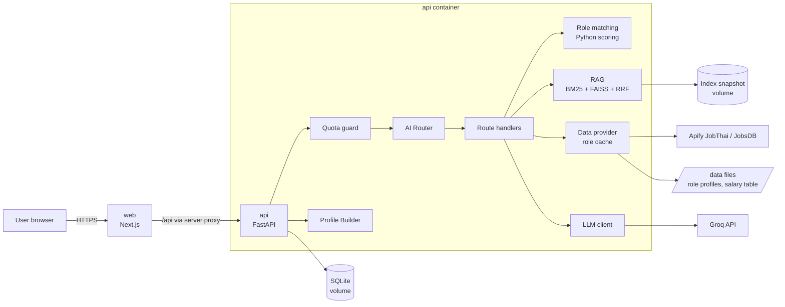
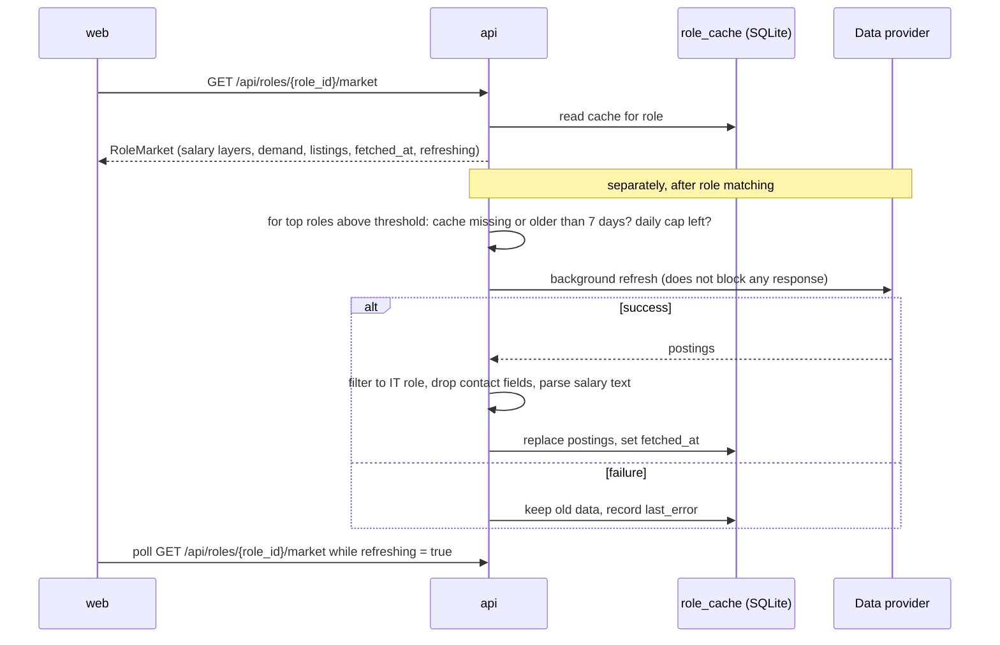

# CareerMirror: Design

<!--
PURPOSE: Architecture and flow only. How the system is put together and how data moves through it.
This file also replaces a separate architecture.md (they would duplicate each other).
DOES NOT CONTAIN: requirements (see PRD.md), UI rules, colours, fonts (see DesignSystem.md),
endpoint shapes (see Contract.md), dates (see Schedule.md). Link to those; do not copy them.
OWNER: backend lead. Update when a component or data flow changes.
-->

Scope and requirements: [PRD.md](PRD.md) · Endpoints: [Contract.md](Contract.md) · UI: [DesignSystem.md](DesignSystem.md)

Status: DRAFT. Items marked (assumed) are proposals, not yet confirmed by the team.

## 1. System overview



Two containers: `web` and `api`. Everything else runs inside `api`. The vector index is the hybrid retrieval from Team-D-II module 05 (BM25 + FAISS + Reciprocal Rank Fusion), stored in SQLite with an in-memory snapshot, so no separate vector-DB container is needed. Numbers (match %, completeness %, salary figures) are always computed or looked up in Python; the LLM only writes explanations (PRD FR-18a).

## 2. Components

| component | responsibility | inputs | outputs |
|---|---|---|---|
| **Web** (Next.js App Router, TypeScript) | Thai UI, consent, CV upload, questionnaire, chat with completeness sidebar, profile, role results, role view | user actions | calls to `/api/*` through the Next.js server proxy (the auth cookie never leaves the server side) |
| **API** (FastAPI) | trust boundary: auth, validation, quota, persistence, orchestration | HTTP requests | JSON per [Contract.md](Contract.md) |
| **Auth** | email + password register/login; JWT (HS256) in an httpOnly cookie | credentials | `user_id` for every request |
| **Quota guard** | per-user daily request and token limit, checked before any LLM call (FR-23, FR-24) | `user_id`, estimated tokens | allow, or `429 QUOTA_EXCEEDED` with reset time |
| **CV parser** | PDF → text → structured fields (skills, education, experience) (FR-1–FR-4) | PDF ≤ 5 MB | draft `CvParsed` for the user to confirm |
| **Profile Builder** | completeness meter (FR-9, FR-14), "Generate profile" (FR-15–FR-17), profile edits (FR-27–FR-34) | CV, answers, chat facts | `Profile` with evidence per claim |
| **AI Router** | picks exactly one route per chat message (FR-11), logs the decision (FR-13) | message + short context | `route`, `confidence`, `layer` |
| **Role matching** | match % per role, matched / missing skills, threshold, top N, gaps (FR-18–FR-20a) | profile, role profiles | `RoleMatch[]` |
| **RAG** | hybrid search over role descriptions, learning paths, soft-skill and work-style notes | query, filters | chunks with source ids |
| **Data provider** | job postings, advertised salaries, demand per role behind one interface; per-role cache (FR-21–FR-22e) | `role_id` | `RoleMarket` with `fetched_at` |
| **LLM client** | Groq chat completions, model from env, retry with backoff, token counting | prompt | text or structured JSON, tokens used |
| **Storage** | SQLite file on a volume (assumed; Postgres only if needed) | – | – |

Reused code (read before writing new): Team-D-II `services/02_api_backend` (app factory, Problem-JSON errors, request-id middleware, body guard, rate limit, JWT cookie auth, Alembic) and `services/05_retrieval_knowledge` (SQLite store, chunking, hybrid search, snapshot swap). Retrieval moves from its own service into `api/app/rag/`.

### 2.1 API code layout (assumed)

```
api/app/
  main.py               app factory, lifespan (open DB, load index snapshot)
  core/                 config, errors (Problem-JSON), logging, security (JWT, password hash)
  api/routes/           auth, me, cv, questionnaire, chat, profile, roles, quota
  services/             use cases: profile_builder, chat_service, quota_service, edit_service
  domain/               pure Python, no FastAPI or DB imports
    matching/           skills.py (taxonomy + aliases) · scoring.py · models.py
    completeness.py · evidence.py · edits.py
  router/               guards, rules, LLM decision, route handlers, prompts
  rag/                  store, chunking, tokenize (pythainlp), embedder, snapshot, hybrid
  providers/            data provider interface, apify_jobthai, reference_table, nso
  infra/                db session + models, migrations glue, llm client
api/tests/              mirrors app/
```

`domain/` stays framework-free so scoring and edit validation are unit-tested without a server.

## 3. Request flow (chat message)

1. `web` sends the message to `POST /api/chat` with the auth cookie.
2. `api` authenticates, validates the body, assigns `request_id`.
3. **Quota guard**: if the user's requests or tokens for today are used up → `429 QUOTA_EXCEEDED`; no LLM call (FR-24).
4. **AI Router** decides the route (section 4.6). Rules and guards cost no tokens; the LLM layer counts toward quota.
5. The route handler fetches only what it needs: profile slices, scoring results, RAG chunks, cached market data (FR-12).
6. The LLM writes the answer from that context. Numbers in the answer must match the computed values; a check rejects mismatches and falls back to a template.
7. `api` records tokens used, logs `request_id`, route, layer, latency and tokens (never CV text), stores the chat message.
8. Response returns the answer, cited sources, any profile-edit proposal, and quota headers.

## 4. Main flows

### 4.1 Intake: CV, questionnaire, chat, completeness

```mermaid
sequenceDiagram
  participant W as web
  participant A as api
  participant DB as SQLite
  W->>A: POST /api/cv (PDF)
  A->>A: check type and size, extract text (pypdf / pdfplumber)
  alt no text layer (scanned)
    A-->>W: 422 CV_UNREADABLE (Thai message)
  else text found
    A->>A: extract skills, education, experience (rules + skill taxonomy; LLM extraction if quota allows)
    A->>DB: save draft (status = draft)
    A-->>W: CvParsed draft
    W->>A: PUT /api/cv/confirm (user-corrected fields)
    A->>DB: save confirmed fields, recompute completeness
  end
  W->>A: PUT /api/questionnaire/answers/{question_id}
  A->>DB: upsert answer (resume later, FR-6)
  W->>A: POST /api/chat (follow-up answers)
  A->>DB: store extracted facts with evidence
  W->>A: GET /api/profile/completeness
  A-->>W: score 0-100, missing slots, can_generate
```

The raw PDF is not stored; only the extracted text (needed as evidence lines) and the confirmed fields. CV text is never written to logs.

**Completeness meter** (assumed weights; a CV-only or questionnaire-only user can reach 60 through chat):

| slot | points | filled by |
|---|---|---|
| hard skills (≥ 3) | 25 | CV, questionnaire checklist or chat |
| experience entries, or "no experience" stated | 15 | CV or chat |
| education | 10 | CV or chat |
| work-style preferences | 20 | questionnaire or chat |
| soft skills (≥ 3 with an example) | 15 | questionnaire or chat |
| goals: interested roles, desired salary, location | 15 | questionnaire or chat |

`can_generate` = (CV confirmed or questionnaire answered) and score ≥ 60 (FR-14, assumed threshold).

### 4.2 Generate profile

```mermaid
sequenceDiagram
  participant W as web
  participant A as api
  participant L as Groq
  W->>A: POST /api/profile/generate
  A->>A: can_generate? quota check
  A->>A: build facts list with evidence ids (CV lines, answers, chat statements)
  A->>A: map free-text skills to taxonomy (aliases, then embedding similarity)
  A->>L: summarise sections from facts only (structured JSON, each claim lists evidence ids)
  L-->>A: draft sections
  A->>A: drop claims without valid evidence ids; drop removed skills
  A->>A: save Profile, run role matching (4.3)
  A-->>W: Profile + RoleMatch summary
```

Profile sections: hard skills, soft skills, work-style preferences (shown as self-reported, FR-17), experience summary, blind spots. Skill levels come from rules (years, project count, self-rating), not from the LLM.

### 4.3 Role matching, threshold, next steps

For each of the ~10 role profiles in `/data/roles/`:

```
hard_required = Σ w·min(user_level / min_level, 1) / Σ w      # missing skill = 0
hard_nice     = share of nice-to-have hard skills the user has
soft          = share of the role's soft skills present in the profile
work_style    = 1 − mean distance between user preferences and role traits (0..1)

match_pct = round(100 × (0.70·hard_required + 0.15·hard_nice + 0.10·soft + 0.05·work_style))   (assumed weights)
```

- Removed skills are excluded (FR-31). Skills are compared by taxonomy id after alias normalisation (Thai and English names).
- Show roles with `match_pct ≥ threshold` (assumed 60, calibrated with three sample profiles: student, full-stack developer, ML developer), top N = 5 (FR-19, FR-20).
- None pass → return the 3 closest roles with `below_threshold = true` and their missing skills (FR-19a).
- **Gaps** per role = missing required skills (sorted by weight) + below-level skills + missing soft skills. Each gap has an id.
- **Next steps** (FR-20a): the LLM receives the gap list plus RAG learning-path chunks for that role and writes up to 5 prioritised actions; each action must reference one gap id. Actions without a valid gap id are dropped.
- Match reasons cite evidence ids for matched skills (FR-16, FR-19).
- After the response, roles that passed the threshold are queued for a cache refresh if stale (4.4).

### 4.4 Role view: cache read, background refresh, fallback



- Reading a role view always uses the cache and never calls the provider directly (FR-22d).
- Seed run before the demo: one fetch per role, committed as the baseline in the volume, not in git (FR-22a).
- Refresh rules: cache age > 7 days (assumed), at most the top 3 roles per match run, at most N refreshes per day in total (assumed 10) (FR-22b, FR-22c).
- On failure the view shows the cached data with its date (NFR reliability).

### 4.5 Profile edit (chat edit and remove button)

```mermaid
sequenceDiagram
  participant W as web
  participant A as api
  participant L as Groq
  W->>A: POST /api/chat "เปลี่ยนสายงานที่อยากได้เป็น Data Engineer"
  A->>A: quota check, router → profile_edit
  A->>L: extract structured change (field, op, new value)
  L-->>A: change
  A->>A: validate against allow-list; fill old value from stored profile
  A-->>W: proposal (Thai text of the exact change) + edit_id
  W->>A: POST /api/profile/edits/{edit_id}/confirm
  A->>A: apply, label edited_by_user, evidence = user_statement
  A->>A: recompute matching, refresh role views
  A-->>W: updated Profile + RoleMatch
  Note over W,A: Remove button: DELETE /api/profile/skills/{skill_id}<br/>no LLM, no quota; adds skill to removed list; recompute
```

- The LLM never writes to the profile (FR-28). Confirm, reject, remove and restore cost no quota and work when quota is exhausted (FR-30, FR-34).
- A removed skill is not re-added from the CV or chat; a chat request to add it back produces a proposal flagged `restores_removed_skill` that the user confirms (FR-31).

### 4.6 AI Router

Layers, reused from Team-D-II module 03:

1. **Guards** (no LLM): empty or too long input, prompt-injection markers, off-topic patterns → `decline`.
2. **Keyword rules** (no LLM): Thai and English patterns per route, confidence 0.9.
3. **LLM decision** (Groq, structured output, counts toward quota) when rules do not match.
4. Low confidence (< 0.6, assumed) → `clarify`.

| route | fetches | LLM writes |
|---|---|---|
| `skill_assessment` | profile hard/soft skills with evidence | assessment text |
| `work_style` | questionnaire work-style answers + RAG work-style notes | description as self-reported preference |
| `blind_spots` | gaps for the user's top roles + RAG soft-skill notes | blind-spot text with evidence |
| `job_matching` | `RoleMatch[]` (computed) + RAG role descriptions | reasons, next steps |
| `salary` | `RoleMarket.salary` from cache (role from message or last picked) | wording of the ranges with source, measure, date |
| `market` | `RoleMarket.demand` and listings from cache | demand summary |
| `experience` | CV experience entries (months computed in Python) | summary |
| `profile_edit` | the targeted field only | structured change (4.5) |
| `clarify` / `decline` | – | one short question / refusal |
| `gap_question` | missing completeness slots | the next follow-up question to fill a gap |

Before a profile exists, most messages route to `gap_question`: chat asks follow-up questions driven by the missing completeness slots (FR-8), and the user's answers become facts with chat evidence. A Thai router evaluation set (about 40 cases, like `eval_routes.py` in Team-D-II) is kept in `api/tests/router/` and its accuracy goes into the report.

## 5. Data model

SQLite, managed with Alembic (assumed). All user tables key on `user_id` and are removed by `DELETE /api/me`.

| table | fields |
|---|---|
| `users` | id, email (unique), password_hash, display_name, consent_at, created_at |
| `cv_documents` | id, user_id, filename, text_lines (JSON list), parsed (JSON), status (draft / confirmed), created_at, confirmed_at |
| `answers` | user_id, question_id, value (JSON), updated_at |
| `chat_messages` | id, user_id, role (user / assistant), text, route, request_id, created_at |
| `facts` | id, user_id, kind (skill / experience / education / preference / soft_skill / goal), value (JSON), evidence_id, created_at |
| `evidence` | id, user_id, kind (cv_line / answer / chat / rag_chunk / user_action), ref, excerpt |
| `profiles` | user_id (PK), sections (JSON with claims and evidence ids), profile_version, generated_at, updated_at |
| `removed_skills` | user_id, skill_id, removed_at |
| `edit_proposals` | id, user_id, changes (JSON), status (pending / applied / rejected / expired), created_at, expires_at |
| `quota_usage` | user_id, day (Asia/Bangkok), requests, tokens |
| `router_log` | request_id, user_id, route, layer, confidence, latency_ms, tokens, created_at (no message text) |
| `role_cache` | role_id (PK), fetched_at, refreshing, last_error, demand (JSON), salary_advertised (JSON) |
| `job_postings` | id, role_id, source, title, company, location, salary_text, salary_min, salary_max, salary_period, posted_at, url, fetched_at |
| `refresh_log` | day, role_id, status, created_at (for the daily cap) |

The retrieval store (`documents`, `chunks`, `meta`) is a separate SQLite file owned by `api/app/rag/`, as in Team-D-II module 05.

## 6. Role profiles and RAG documents

Authored files in `/data` (labelled team-curated in the UI):

```
data/
  roles/<role_id>.json        structured role profile
  roles/<role_id>.md          prose description + learning path (RAG source)
  skills/taxonomy.json        skill ids, category, Thai/English aliases
  rag/work_style.md           what each work-style preference means at work
  rag/soft_skills.md          soft skills in IT roles with observable examples
  salary/reference.csv        role_id, min, max, measure, source, url, retrieved_at
  questionnaire.json          question ids, type, options, which slot they fill
```

Role list (assumed, confirm with team): `ai_engineer`, `ml_engineer`, `data_scientist`, `data_engineer`, `data_analyst`, `backend_developer`, `frontend_developer`, `fullstack_developer`, `devops_engineer`, `qa_engineer`.

Role profile shape:

```json
{
  "role_id": "backend_developer",
  "title_th": "นักพัฒนาแบ็กเอนด์",
  "title_en": "Backend Developer",
  "required": [{"skill_id": "python", "min_level": 2, "weight": 3}],
  "nice_to_have": ["docker", "redis"],
  "soft_skills": ["communication", "problem_solving"],
  "work_style": {"teamwork": 0.6, "structure": 0.7},
  "author": "sakda1306",
  "sources": [{"title": "...", "url": "...", "retrieved_at": "2026-11-01"}]
}
```

Skill levels: 1 = basic, 2 = working, 3 = strong, 4 = expert.

**RAG indexing**: categories `role_description`, `learning_path`, `work_style`, `soft_skill`. Markdown is chunked at `## ` headings; each chunk keeps `doc_id`, `category`, `role_id` and source so citations point to a real chunk. Search is hybrid (BM25 with pythainlp tokenisation + FAISS over multilingual embeddings, fused with RRF k = 60) with a `role_id` / `category` filter. Embedding model: `BAAI/bge-m3` or `intfloat/multilingual-e5-base` (assumed); pick by a small Thai golden set (hit@3) on day 1. Embeddings are also used to map free-text skills to taxonomy ids when alias lookup fails (similarity threshold assumed 0.75); they never produce a match %.

## 7. External data and caching

```python
class JobDataProvider(Protocol):
    name: str
    def fetch_postings(self, role: RoleProfile, limit: int) -> list[Posting]: ...
```

| source | layer | used for | notes |
|---|---|---|---|
| Apify JobThai scraper (`jobTypes` = 7 Computer/IT, `includeDetails` on, `includeContacts` off) | advertised | postings, salary text, demand count, trending skills | unofficial; free plan 20 jobs per run; pay per result |
| Apify JobsDB scraper | advertised | same | optional second source |
| `data/salary/reference.csv` | reference | curated ranges per role with source and date | team-curated |
| NSO / data.go.th IT-industry wage | sanity check | one baseline figure by industry | not by job title |

- Ingest filters postings to the role (title keywords + taxonomy skills in the description) and drops contact fields (FR-22e).
- Salary text is parsed into min, max and period (`month` / `year`); unparseable salaries are kept as text only and excluded from ranges.
- **Demand** = posting count in the last fetch, plus the top skills by frequency in descriptions.
- Two salary layers are always returned separately, each with source, measure and date (FR-21). No single "true" salary figure.

## 8. Deployment

`docker compose up --build` starts:

| service | image | port | volumes |
|---|---|---|---|
| `web` | `web/Dockerfile` (Node 20, Next.js standalone) | 3000 (host) | – |
| `api` | `api/Dockerfile` (Python 3.12, uvicorn, **one worker** because the search index lives in memory) | 8000 (internal; host only in dev) | `api-data:/app/var` (SQLite files, index snapshot, embedding model cache) |

`/data` is mounted read-only into `api`.

Environment variables (names only; values live in `.env`, only `.env.example` is committed):
`APP_NAME`, `JWT_SECRET`, `JWT_TTL_HOURS`, `DATABASE_URL`, `RAG_DB_PATH`, `EMBED_MODEL`, `GROQ_API_KEY`, `GROQ_MODEL`, `LLM_TIMEOUT_S`, `QUOTA_DAILY_REQUESTS`, `QUOTA_DAILY_TOKENS`, `QUOTA_TZ`, `MATCH_THRESHOLD`, `TOP_N_ROLES`, `CACHE_MAX_AGE_DAYS`, `REFRESH_DAILY_CAP`, `APIFY_TOKEN`, `APIFY_JOBTHAI_ACTOR`, `CORS_ALLOWED_ORIGINS`, `API_BASE_URL` (web), `LOG_LEVEL`.

## 9. Decisions and trade-offs

| decision | alternative | reason |
|---|---|---|
| Match % in Python, LLM only explains | LLM scores the match | consistent, explainable, cheaper; the exact problem the product fixes (PRD §2) |
| Profile vs ~10 role profiles | profile vs individual postings | stable, explainable scores; postings are noisy and capped at 20 per run |
| Hybrid BM25 + FAISS + RRF inside `api` (reused from Team-D-II 05) | Chroma container | already built and tested on Thai text; BM25 catches exact skill names that vectors miss; one less container in a 6-day project |
| Two containers (`web`, `api`) | separate router, retrieval, generation services as in Team-D-II | two people; fewer contracts and integration points |
| SQLite on a volume | Postgres | enough for a demo; zero setup (PRD open question 6) |
| Email + password login, JWT in httpOnly cookie | anonymous session | data and quota survive a browser change; JWT cookie code reused from Team-D-II |
| Market data read from cache, refreshed in background | live API call per view | demo cannot depend on a capped, unofficial scraper |
| Raw PDF not stored | keep the file | less personal data; extracted lines are enough as evidence |
| Edit proposals confirmed by the user | apply LLM edits directly | the LLM never writes to the profile (FR-28) |

## 10. Open questions

1. Role list and who writes each role profile (PRD 5a).
2. Scoring weights (0.70 / 0.15 / 0.10 / 0.05), match threshold and completeness threshold: calibrate with sample profiles on 3 Nov.
3. Groq model and its daily limits → quota numbers.
4. Embedding model choice after the Thai golden-set test.
5. Is LLM-assisted CV extraction allowed to count toward quota, or should CV parsing be rules-only?
