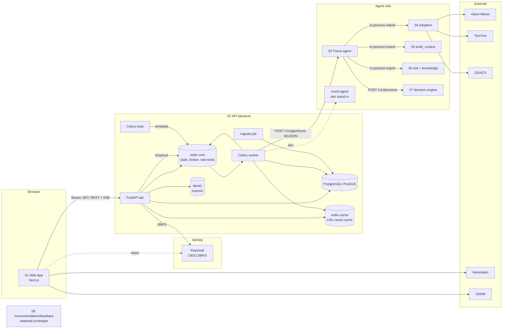
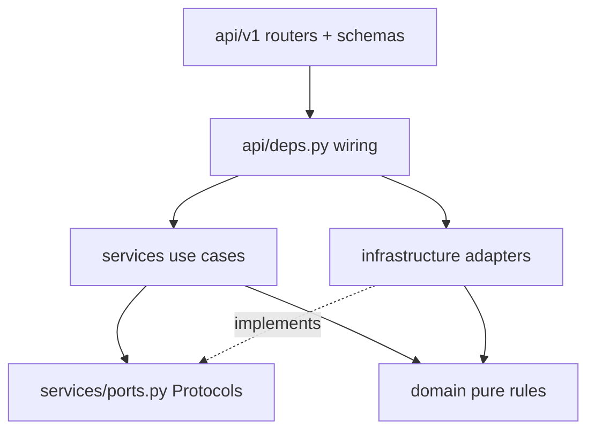

# 01 — Architecture

> Paths are relative to `DL-07-Agentic-AI-System-II/`.

## System diagram

Sources: `02_api_backend/docker-compose.yml`, `03_travel_ai_agent/travel_agent/tools/live.py:84-111` (04/05/06 loaded in-process from sibling folders), `03_travel_ai_agent/travel_agent/tools/decision.py`, `01_web_app/lib/geocode.ts:59`, `01_web_app/lib/routing.ts:25`. Module 08 is not called by 02 or 03 (no reference found).

## Components

### 01 Web App
- **Responsibility:** form → geocode → call API → follow job via SSE → render dashboard + map; mock fallback on error.
- **Inputs:** user text (origin, destination, date, mode, note). **Outputs:** `POST /v1/travel/recommendations`.
- **Key files:** `01_web_app/components/trip-context.tsx`, `01_web_app/lib/api/client.ts`, `01_web_app/lib/api/index.ts`, `01_web_app/components/travel-form.tsx`.

### 02 API (FastAPI)
- **Responsibility:** trust boundary. Auth, scopes, rate limits, idempotency, validation/normalization, persistence, job creation, SSE, history, conversations, trips, feedback, admin, ops. **Never calls the Agent itself** (`02_api_backend/app/services/recommendation_service.py:3`).
- **Inputs:** HTTP JSON. **Outputs:** JSON / `application/problem+json` / `text/event-stream`.
- **Key files:** `app/main.py:33` (factory), `app/api/deps.py` (wiring), `app/api/v1/router.py`, `app/services/*.py`.

### 02 Worker (Celery)
- **Responsibility:** the only Agent caller; applies Safety Gate; stores result; publishes job events; writes cache.
- **Queues:** `recommendations`, `alerts`, `maintenance` (`docker-compose.yml` worker command).
- **Key files:** `app/workers/tasks/recommendation.py:19`, `app/services/agent_run_service.py:166`, `app/workers/runtime.py`.

### 02 Beat
- **Responsibility:** periodic jobs: trip alert scan, stuck-job reaper, nightly purge (`app/workers/schedule.py:17-43`).

### 02 Infrastructure adapters
- **DB:** async SQLAlchemy repos (`app/infrastructure/db/repositories/*.py`), session factory (`app/infrastructure/db/session.py:33`).
- **Redis stores:** rate limiter, idempotency, job state (Streams), slots, tickets, cache, cooldown, circuit breaker (`app/infrastructure/redis/*.py`, keys in `keys.py`).
- **Agent client:** `app/infrastructure/agent/client.py:150` + breaker `circuit_breaker.py`.
- **Object store:** `app/infrastructure/storage/object_store.py:33`.

### 03 Travel agent
- **Responsibility:** orchestrate tools under a step/tool/time budget, collect evidence, call 07, map result to 02 contract. Does **not** decide safety (`03_travel_ai_agent/README.md`).
- **Inputs:** `AgentRunRequest` (`travel_agent/contracts.py`). **Outputs:** `AgentRunResponse` JSON or NDJSON progress stream.
- **Key files:** `travel_agent/pipeline.py:99`, `travel_agent/tools/base.py:27` (allowlist), `travel_agent/api.py:122`.

### 04 External data
- **Responsibility:** call provider, convert to canonical record, or return an explicit `status: "unavailable"` record (never fake data).
- **Key files:** `04_external_data_services/weather_service.py:32-66`, `tomtom_transport.py:219`, `gdacs_adapter.py:204`.

### 05 Data integration
- **Responsibility:** match records to timed route segments, build integrated context. **Key file:** `05_data_integration/integration.py:387`.

### 06 Risk + knowledge
- **Responsibility:** rule-based risk score, filtered BM25 retrieval of approved passages, route exposure. **Key files:** `06_risk_knowledge_services/risk_knowledge/service.py`, `risk.py`, `knowledge.py:64`, `routing.py`.

### 07 Decision + LLM engine
- **Responsibility:** validate evidence, apply versioned rule table, compute confidence, attach emergency instructions, generate explanation (template or validated LLM candidate), write audit JSONL.
- **Key files:** `decision_engine/policy.py:85`, `decision_engine/policies/prototype-v3.json`, `decision_engine/explanation.py:52`, `decision_engine/audit.py`, `decision_engine/api.py:51`.

### 08 Recommendation/feedback (standalone)
- **Responsibility:** format 07 output, validate emergency contacts, store in Postgres, feedback + safety queue, Redis live-update dedup/cooldown.
- **Key files:** `08_recommendation_feedback/app/main.py`, `app/db.py`, `app/live_update.py`, `db_schema.sql`.

## Layering rules (02, enforced)

| Rule | Evidence |
|---|---|
| Routers only parse/validate, build a command, call one service, map to schema | `app/api/v1/recommendations.py:45-64` |
| `deps.py` is the **only** api module that imports infrastructure | `app/api/deps.py:1` docstring |
| Services depend on `Protocol` ports, not concrete classes | `app/services/ports.py` (770 lines of Protocols/records) |
| Domain is framework-free: no fastapi, starlette, sqlalchemy, redis, httpx, pydantic, or other app layers | Enforced by AST test `tests/unit/domain/test_layering.py:10-22` |
| API process never calls the Agent; only the worker does (D-03) | `app/services/recommendation_service.py:3`, `app/services/agent_run_service.py:3` |
| Shared resources built once in lifespan, injected via `app.state.resources` | `app/main.py:43-55`, `app/api/resources.py` |

Dependency direction: `api → services → ports ← infrastructure`, and everything may use `domain` + `core`. The domain never imports outward.

Other modules: 03 uses the same idea in miniature: a `ToolSet` Protocol (`travel_agent/tools/base.py:50`) with `LiveToolSet` and `MockToolSet` implementations.
