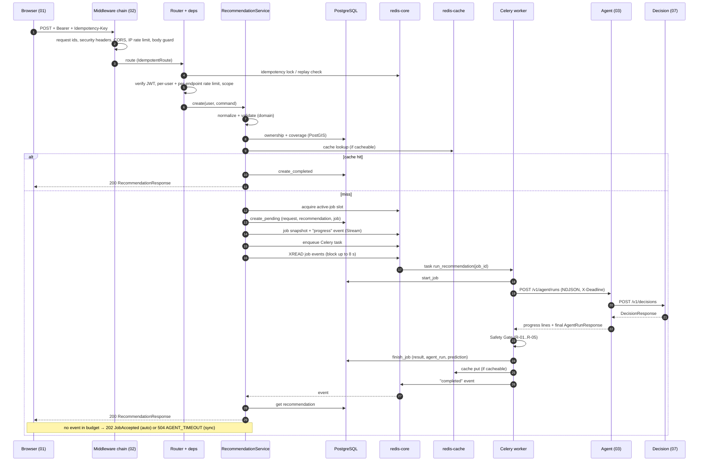

# 02 — Request lifecycle

> Paths are relative to `DL-07-Agentic-AI-System-II/`. The traced request is `POST /v1/travel/recommendations?mode=auto`, the main flow of the system.

## Sequence

## Numbered steps

| # | Step | File reference |
|---|---|---|
| 1 | Browser builds headers: `Authorization`, `Accept-Language`, `Idempotency-Key` (UUIDv7) on every POST | `01_web_app/lib/api/client.ts:67-77` |
| 2 | OpenTelemetry server span wraps everything (added last = outermost) | `02_api_backend/app/main.py:113` |
| 3 | `RequestContextMiddleware`: request id + correlation id, bound to logs | `app/main.py:109`, `app/api/middleware/request_context.py` |
| 4 | `SecurityHeadersMiddleware` (HSTS only in prod) | `app/main.py:108` |
| 5 | `CORSMiddleware`: explicit origins, no credentials, exposes `Retry-After`, `RateLimit-*`, `Idempotent-Replayed` | `app/main.py:81-107` |
| 6 | `IPRateLimitMiddleware`: keyed-hash of client IP, sliding window (default 120/min); exempt `/health`, `/ready`, `/metrics` | `app/api/middleware/rate_limit.py:17-45` |
| 7 | `BodyGuardMiddleware`: max body (default 64 KiB), JSON content type | `app/main.py:75-79`, `app/api/middleware/body_guard.py:30` |
| 8 | `IdempotentRoute`: key format `^[A-Za-z0-9._:-]{8,128}$`, fingerprint = SHA-256 of method+path+canonical JSON; replays stored 2xx with `Idempotent-Replayed: true` | `app/api/idempotency.py:29-60` |
| 9 | `get_principal`: Bearer parse → `token_verifier.verify` (JWKS or dev HS256) → per-user rate limit (default 60/min) | `app/api/auth.py:61-77` |
| 10 | `require_scopes(Scope.TRAVEL_WRITE)` → 403 with `WWW-Authenticate: insufficient_scope` | `app/api/auth.py:93-109`, `app/api/v1/recommendations.py:43` |
| 11 | `recommend_rate_limit`: extra per-user limit for this endpoint (default 10/min) | `app/api/auth.py:132-134` |
| 12 | `get_current_user`: resolve/create user row from principal (cached on `request.state`) | `app/api/deps.py:59-68` |
| 13 | Router converts schema → domain command | `app/api/v1/recommendations.py:54-60` |
| 14 | `normalize_travel_request` (limits: waypoints, days ahead, question chars, min distance) | `app/services/recommendation_service.py:218-229` |
| 15 | Ownership check: another user's conversation/trip returns 404 (not 403) | `recommendation_service.py:231-240` |
| 16 | Coverage check via PostGIS `region_for` → 422 `UNSUPPORTED_REGION` | `recommendation_service.py:242-251` |
| 17 | Cache: only without question/conversation; key = SHA-256 of geohash cells + time bucket + prefs + language | `app/domain/cache_policy.py:21-45`, `recommendation_service.py:182-202` |
| 18 | Active-job slot (default 3 per user) → 429 `TOO_MANY_ACTIVE_JOBS` | `recommendation_service.py:279-294` |
| 19 | Persist pending rows; on enqueue failure mark job failed + 503 | `recommendation_service.py:206-212`, `302-369` |
| 20 | Wait on Redis Stream for `completed`/terminal event, max `SYNC_AGENT_TIMEOUT_SECONDS` (8 s) | `recommendation_service.py:371-394` |
| 21 | Worker task binds correlation id, runs `AgentRunService.run` | `app/workers/tasks/recommendation.py:19-35` |
| 22 | Agent call in a task raced against a cancel watcher | `app/services/agent_run_service.py:187-212` |
| 23 | Safety Gate; rejection → `AGENT_BAD_RESPONSE` or `DEPENDENCY_UNAVAILABLE` | `agent_run_service.py:217-245`, `app/domain/safety_gate.py:162` |
| 24 | Store result, metrics, cache put (TTL = min(valid_until − now, 300 s)), publish `completed` | `agent_run_service.py:247-302`, `app/domain/cache_policy.py:48-62` |
| 25 | Response serialized; errors become RFC 9457 Problem Details | `app/api/v1/responses.py:16`, `app/api/problem.py:15-55` |

## Error handling

| Where | Behaviour | File |
|---|---|---|
| Any `AppError` | Problem Details with `code`, `request_id`, `correlation_id`, `Retry-After` when set; 5xx logged | `app/api/error_handlers.py:41-45`, `app/api/problem.py:58` |
| Pydantic validation | 422 `VALIDATION_ERROR`; field paths cleaned; **input value never echoed** (PII) | `app/api/error_handlers.py:28-37` |
| Unhandled exception | 500 `INTERNAL_ERROR`, logged with type only | `app/api/error_handlers.py:75-79` |
| Middleware errors | Sent as Problem Details at ASGI level | `app/api/middleware/problem_asgi.py` |
| Redis down for rate limit | Fail-open by default (`RATE_LIMIT_FAIL_OPEN`) | `app/api/auth.py:42-46` |
| Worker crash | Job marked `INTERNAL_ERROR`, terminal event still published, slot released in `finally` | `app/services/agent_run_service.py:176-183` |
| Frontend | `ApiError.isRetryable` = 408, 429, ≥500; React Query retries queries max 2, mutations never | `01_web_app/lib/api/problem.ts:38`, `01_web_app/components/providers.tsx:13-17` |

Status mapping: 400 INVALID_REQUEST, 401 UNAUTHENTICATED, 403 FORBIDDEN, 404 NOT_FOUND, 409 IDEMPOTENCY_* / JOB_NOT_CANCELLABLE / REVIEW_NOT_PENDING, 413, 415, 422 VALIDATION_ERROR / UNSUPPORTED_REGION, 429 RATE_LIMITED / TOO_MANY_ACTIVE_JOBS, 500, 502 AGENT_BAD_RESPONSE, 503 DEPENDENCY_UNAVAILABLE, 504 AGENT_TIMEOUT (`app/core/errors.py:39-93`).

## Retries and timeouts (worker → Agent)

| Setting | Default | File |
|---|---|---|
| Total job deadline | 60 s (`JOB_AGENT_TIMEOUT_SECONDS`) | `app/core/config.py:169` |
| Sync wait in API | 8 s | `app/core/config.py:168` |
| Connect timeout | 2 s | `app/core/config.py:167` |
| Retries | 2 (3 attempts) | `app/core/config.py:170`, `app/infrastructure/agent/client.py:183` |
| Backoff | `base * 2^(n-1) + jitter*base`, at least `Retry-After`; give up if delay ≥ remaining deadline | `client.py:454-457`, `client.py:238-241` |
| Retryable | connect errors, retryable HTTP statuses; 4xx not retried | `client.py:347-370` |
| Circuit breaker | 5 failures / 30 s window → open 30 s → half-open single probe; state in Redis, fail-open if Redis down | `app/infrastructure/agent/circuit_breaker.py:1-60`, `config.py:171-173` |
| Whole-call bound | `asyncio.timeout(remaining)` around httpx per-op timeouts | `client.py:312-318` |
| Deadline propagation | `X-Deadline` header to the Agent; Agent caps its tool calls (5 s each) and total (60 s) | `client.py:445-446`, `03_travel_ai_agent/travel_agent/config.py:23-28` |
| Response size cap | 5 MiB | `config.py:165` |
| Cancel | `DELETE /v1/agent/runs/{id}` after interrupt, 2 s timeout | `client.py:267-273`, `464` |

## Streaming

- **Agent → worker:** NDJSON progress lines when `on_progress` is given (`client.py:304`, `client.py:395-428`; producer `03_travel_ai_agent/travel_agent/api.py:208`).
- **Worker → API/browser:** events written to a Redis Stream per job (`XADD ... MAXLEN`, TTL = job result TTL) and read with `XREAD` (`app/infrastructure/redis/job_state.py:117-144`).
- **Browser:** SSE at `GET /v1/jobs/{id}/events`. `EventSource` cannot send headers, so the client first gets a single-use ticket (`POST /v1/jobs/{id}/stream-ticket`, 60 s) (`app/api/v1/jobs.py:103-152`). Supports `Last-Event-ID`, heartbeat every 15 s, max 300 s per stream, max 3 streams per user (`app/services/job_service.py:108-170`, `config.py:204-233`). Response headers `Cache-Control: no-store`, `X-Accel-Buffering: no` (`jobs.py:151`).
- **Frontend consumer:** `followRecommendationJob` with 45 s client timeout (`01_web_app/lib/api/index.ts`).
