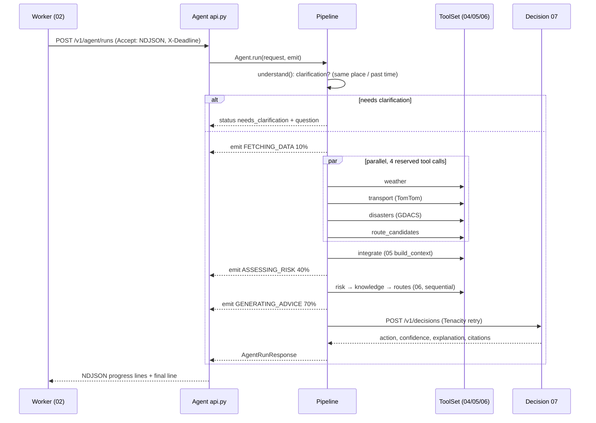
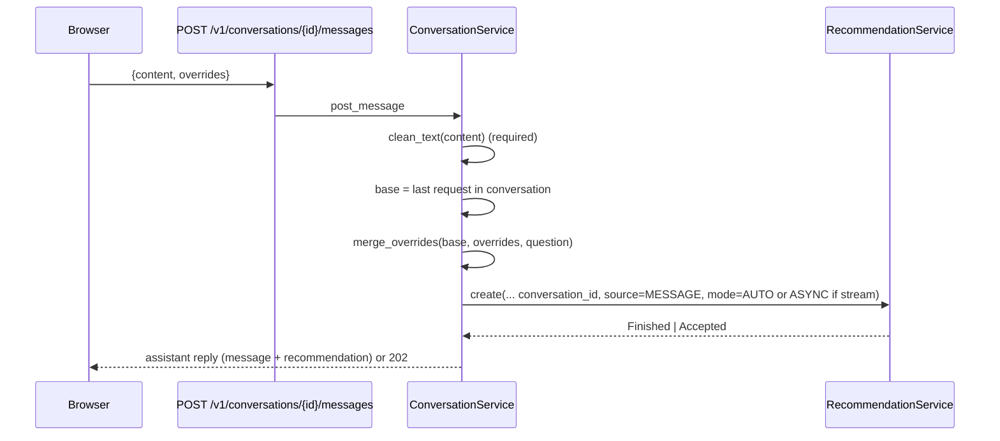
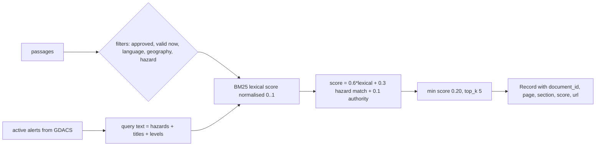

# 03 — Main user flows

> Paths are relative to `DL-07-Agentic-AI-System-II/`.

**Upload/parse flow: Not found in code.** No file upload endpoint, no multipart handling, no PDF parsing. The body guard only accepts JSON up to 64 KiB (`02_api_backend/app/api/middleware/body_guard.py:23-36`, `app/core/config.py:44`). The only "file" flows are server-generated exports to MinIO (flow F below).

---

## A. Recommendation ("generation") flow

See `02-request-flow.md` for the full API-side trace. This section covers the agent side (03 → 04/05/06 → 07).

| # | Step | File |
|---|---|---|
| 1 | Auth check on agent API, NDJSON or JSON response chosen by `Accept` | `03_travel_ai_agent/travel_agent/api.py:102`, `122-170`, `208` |
| 2 | Budget: max steps 12, max tool calls min(20, request limit), per-tool timeout 5 s, total 60 s | `travel_agent/config.py:23-29`, `travel_agent/pipeline.py:107-110` |
| 3 | `understand()`: ask instead of guessing (Thai/English question + `missing_fields`) | `pipeline.py:254-279` |
| 4 | Parallel fetch with `asyncio.gather`, budget reserved first | `pipeline.py:147-167` |
| 5 | Every tool call goes through `_call`: allowlist, timeout, failure ⇒ service marked `UNAVAILABLE`, run continues (bulkhead) | `pipeline.py:208-241`, `tools/base.py:27-38` |
| 6 | Integrate, assess (risk → knowledge → routes) | `pipeline.py:169-192` |
| 7 | Decide: 07 missing ⇒ `503 DECISION_UNAVAILABLE`; `request_id` mismatch ⇒ `503 DECISION_MISMATCH` | `pipeline.py:194-205` |
| 8 | Build 02-shaped response; 07 emergency text passed through verbatim | `travel_agent/response.py`, `README.md` |
| 9 | Back in 02: Safety Gate R-01..R-05 before storing | `02_api_backend/app/domain/safety_gate.py:162-202` |

---

## B. Chat / follow-up (conversations)

| # | Step | File |
|---|---|---|
| 1 | Create conversation (`language`, `title`) | `02_api_backend/app/api/v1/conversations.py:38` |
| 2 | First message carries the whole trip in `overrides`; later messages send only changes | `02_api_backend/README.md` "Conversations" |
| 3 | Text cleaned; empty ⇒ 422 | `app/services/conversation_service.py:128-133`, `app/domain/sanitizer.py:20` |
| 4 | Merge with last request (pure domain) | `app/domain/follow_up.py:101` |
| 5 | Reuses the recommendation pipeline; conversation requests are never cached | `conversation_service.py:143-153`, `app/domain/cache_policy.py:21-23` |
| 6 | Worker sends last N messages (default 10) as Agent context; intent hint `FOLLOW_UP` if context exists, else `CHECK_SAFETY` | `app/core/config.py:174`, `app/services/agent_run_service.py:379` |
| 7 | Message text encrypted at rest | `app/infrastructure/db/models/conversation.py:62` |
| 8 | History: `GET .../messages` cursor pagination | `app/api/v1/conversations.py:107`, `app/services/pagination.py` |

No LLM-based intent classification exists. Intent is a hint chosen by one `if` in 02 (`agent_run_service.py:379`); 03 says an LLM classifier "comes later" (`03_travel_ai_agent/travel_agent/pipeline.py:257`).

---

## C. Search / retrieval (disaster knowledge)

Details in `05-rag.md`. Entry: `06_risk_knowledge_services/risk_knowledge/knowledge.py:64`; called from `03_travel_ai_agent/travel_agent/pipeline.py:187-190`.

---

## D. Background jobs

| Job | Trigger | What it does | File |
|---|---|---|---|
| `run_recommendation` | API enqueue | Flow A + store + publish | `app/workers/tasks/recommendation.py:19` |
| `scan_trip_alerts` | Beat every 15 min (queue `alerts`) | Finds trips with alerts on, leaving within 24 h, assessment older than 60 min; enqueues async re-assessment (batch 100). Risk change ⇒ assistant message in trip conversation | `app/workers/schedule.py:27-31`, `app/services/trip_alert_service.py:45-90` |
| `reap_stuck_jobs` | Beat every 5 min | Fails jobs stuck past their lifetime | `app/workers/schedule.py:32-36`, `app/services/reaper_service.py` |
| `purge_expired` | Cron `0 3 * * *` Asia/Bangkok | Deletes rows past `expires_at`, manages monthly audit partitions | `app/workers/schedule.py:38-42`, `app/services/purge_service.py` |
| `delete_account` | `DELETE /v1/me` | Stops jobs, removes data; account gets 403 meanwhile | `app/workers/runtime.py:195`, `README.md` |
| `build_data_export` | `POST /v1/me/data-export` | Zips user data to MinIO; link valid 15 min; kept 7 days | `app/services/export_service.py:76-130` |
| `build_training_export` | Admin POST | gzip JSONL of anonymised predictions + approved feedback | `app/services/training_export_service.py` |
| 08 retention loop | `asyncio.create_task` in lifespan, every 24 h | Purges feedback older than retention days | `08_recommendation_feedback/app/main.py:44-60` |

Worker runtime pattern: sync Celery task → one event loop per process → async service (`app/workers/runtime.py:175-220`).

---

## E. Feedback and safety review

| # | Step | File |
|---|---|---|
| 1 | `POST /v1/recommendations/{id}/feedback` (rating, helpful, outcome, report_type, comment) | `app/api/v1/feedback.py:23`, `app/schemas/v1/feedback.py:20-26` |
| 2 | `UNSAFE_ADVICE` / `INCORRECT_INFO` ⇒ review queue + audit row | `02_api_backend/README.md` "Feedback and safety review" |
| 3 | Reviewer (`safety:review` scope) lists and approves/rejects; every review audited | `app/api/v1/admin/reviews.py:20-43` |
| 4 | Only approved feedback is `usable_for_training` | `app/infrastructure/db/models/mlops.py:104` |

---

## F. Data export (the only file-producing flow)

| # | Step | File |
|---|---|---|
| 1 | Daily cooldown claimed in Redis with `SET NX EX`; second request ⇒ 429 with `Retry-After` = TTL | `app/infrastructure/redis/cooldown.py:15-20`, `app/services/export_service.py:76-84` |
| 2 | Enqueue; on failure release cooldown and return 503 | `export_service.py:86-92` |
| 3 | Worker builds zip, uploads to MinIO bucket | `app/infrastructure/storage/object_store.py:60-73` |
| 4 | `GET /v1/me/data-export/{id}` returns presigned URL (15 min) | `app/api/v1/exports.py:79`, `config.py:275` |

---

## G. Frontend submit flow

| # | Step | File |
|---|---|---|
| 1 | zod-validated form (origin, destination, date, mode, note ≤240) | `01_web_app/components/travel-form.tsx:8-15` |
| 2 | Geocode both names via Nominatim (throttled ≥1.1 s between calls) | `01_web_app/lib/geocode.ts:55-70` |
| 3 | Road modes: OSRM route for map in parallel | `01_web_app/components/trip-context.tsx:72-76`, `lib/routing.ts:20-30` |
| 4 | `requestRecommendation` → 200 or 202 + SSE | `trip-context.tsx:82-99`, `lib/api/index.ts` |
| 5 | Stale-response guard: request sequence number | `trip-context.tsx:50-51` |
| 6 | Any error ⇒ show message **and** a locally built mock recommendation, `usingMock=true` | `trip-context.tsx:104-111`, `lib/mock-recommendation.ts` |
