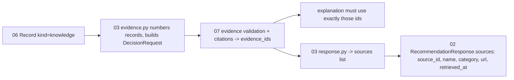

# 05 — RAG / knowledge retrieval

> Paths are relative to `DL-07-Agentic-AI-System-II/`.

## Headline fact

Retrieval is **lexical (BM25) over in-memory passages with hard filters**. There is **no vector store, no embedding model, no chunker and no corpus** in the code. The module README states: "No operational safety corpus is bundled" (`06_risk_knowledge_services/README.md`). The live agent builds `RiskKnowledgeService(clock=clock)` without passages (`03_travel_ai_agent/travel_agent/tools/live.py:241`), so in live runs the knowledge result is always empty.

## Summary table

| Topic | In this codebase | File |
|---|---|---|
| Document sources | Not found in code (passages must be supplied by the team; `approved` defaults to False) | `06_risk_knowledge_services/risk_knowledge/models.py:195-208` |
| Loading | Passed to the constructor as an iterable of dicts/models | `risk_knowledge/service.py:16-28` |
| Chunking | Not found in code. A "passage" is pre-chunked: `text` max 3500 chars + `page` + `section` | `models.py:205-207` |
| Embeddings | Not found in code. Env names `EMBEDDING_MODEL`, `COLLECTION_VERSION`, `TOP_K`, `RERANK_TOP_N` exist only in `/.env.example`, unused | `/.env.example` |
| Vector store | Not found in code | — |
| Retrieval | BM25 (k1=1.2, b=0.75), scores normalised to max = 1 | `knowledge.py:32-51` |
| Filters (before scoring) | `approved`, `effective_at <= now < expires_at`, language root match (or `multi`/`*`), geography match (or `*`), hazard overlap | `knowledge.py:99-117`, `knowledge.py:54-57` |
| Gate | No active alert ⇒ empty result (no retrieval at all) | `knowledge.py:86-88` |
| Reranking | Deterministic: `min(1, 0.6*lexical + 0.3 if hazard match + 0.1 if authority)` | `knowledge.py:121-128` |
| Threshold / top-k | `minimum_score=0.20`, `top_k=5` (allowed 1–20) | `knowledge.py:70-82` |
| Tie-break | `(-score, document_id, section)` (stable, reproducible) | `knowledge.py:129` |
| Tokenizer | Regex `[\w฀-๿]+`, casefold, length > 1 (Thai chars kept but no word segmentation) | `knowledge.py:25-29` |
| Citations | Each hit → `Record(kind="knowledge", source_name=authority, url, official_source=True, observed_at, fetched_at, expires_at, excerpt)`; excerpt prefixed with `[document_id=…; page=…; section=…; retrieval_score=…]` | `knowledge.py:131-148` |
| Index build / seed | Not found in code | — |
| Query construction | Not from user text: built from active alerts (hazard types + titles + levels) | `knowledge.py:90-98` |

## Passage schema

```text
KnowledgePassage (06_risk_knowledge_services/risk_knowledge/models.py:195)
  document_id   Identifier
  authority     str 1..200
  title         str 1..300
  url           HttpUrl
  language      str
  geography     list[str] = ["*"]
  hazard_types  list[str] = []
  effective_at  AwareDatetime
  expires_at    AwareDatetime   (must be > effective_at)
  page          int|None >= 1
  section       str 1..200
  text          str 1..3500
  approved      bool = False
```

## How citations reach the user



Files: `03_travel_ai_agent/travel_agent/evidence.py`, `03_travel_ai_agent/travel_agent/pipeline.py:282-296` (record numbering), `07_decision_llm_engine/decision_engine/service.py:33-35` (citation ids into `explain`), `02_api_backend/app/schemas/v1/travel.py:171-176` (`SourceItem`).

Every evidence record carries `source`, `url` (https), `observed_at`, `fetched_at`, `expires_at`; 07 enforces `observed_at <= fetched_at < expires_at` (`03_travel_ai_agent/README.md` "ข้อมูลที่ต้องตกลงกับทีม").

## Tests

`06_risk_knowledge_services/tests/test_services.py` (436 lines) covers filters and scoring with in-test passages.

## What to reuse for CareerMirror (Chroma + local multilingual embeddings)

| Keep | Replace |
|---|---|
| Metadata filters applied **before** scoring (CareerMirror: `role_id`, `language`, `seniority`, `updated_at`, `approved`) | BM25 scorer → Chroma `query(where=…)` with the embedding model |
| Hybrid rerank formula (semantic score + fixed bonuses) | Add chunker (Not found here): e.g. 500–800 chars with ~100 overlap, split on Thai-aware boundaries (inferred recommendation) |
| `minimum_score` + `top_k` + "empty means not enough evidence" | Seed script that builds the collection with `COLLECTION_VERSION` metadata (Not found here) |
| Citation excerpt format `[document_id; section; score]` and passing ids to the explainer | — |
| Deterministic tie-break for reproducible tests | — |
