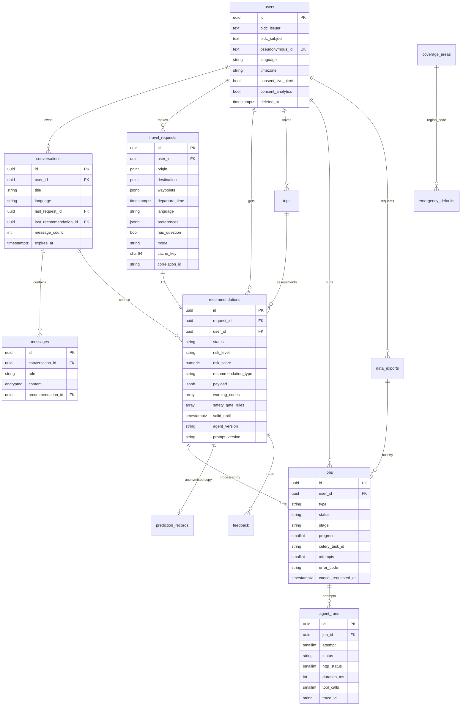

# 06 — Data model

> Paths are relative to `DL-07-Agentic-AI-System-II/`. Main store: PostgreSQL 16 + PostGIS (`02_api_backend/docker-compose.yml` `postgres`). SQLite: Not found in code.

## Shared column helpers (02)

| Mixin | Columns | File |
|---|---|---|
| `UUIDPrimaryKey` | `id UUID` (UUIDv7 via `new_id`) | `02_api_backend/app/infrastructure/db/base.py:39-40`, `app/core/ids.py` |
| `CreatedAt` | `created_at timestamptz default now()` | `base.py:43-44` |
| `Timestamps` | + `updated_at` | `base.py:47-48` |
| Naming convention | Explicit constraint/index names | `base.py:25-36` |
| `EncryptedText` | AES-256-GCM, `enc:v1:<key id>:<b64>`, column name as associated data, key rotation | `app/infrastructure/db/types.py:13-28`, `app/core/encryption.py:1-8` |
| `expires_at` | On almost every user table; drives the nightly purge | models below, `app/services/purge_service.py` |

## ER diagram (02, core tables)

## Tables (02)

| Table | Purpose | Notable fields / types | File |
|---|---|---|---|
| `users` | Identity mapping (OIDC issuer+subject → internal id) + profile + consents | `pseudonymous_id` unique; `language` default `th`; `timezone` default `Asia/Bangkok`; consent bool + `*_at`; soft `deleted_at` | `app/infrastructure/db/models/user.py:14-31` |
| `conversations` | Chat thread | `last_request_id`, `last_recommendation_id` (`use_alter` FKs), `message_count`, `expires_at` | `models/conversation.py:24-42` |
| `messages` | Chat messages | `role String(16)`, `content EncryptedText`, optional `recommendation_id` | `models/conversation.py:46-64` |
| `travel_requests` | Normalised input | PostGIS `POINT` origin/destination, `waypoints JSONB`, `preferences JSONB`, `cache_key CHAR(64)` | `models/request.py:27-54` |
| `recommendations` | Result + denormalised fields for listing | `payload JSONB` (full response), `risk_score Numeric(4,3)`, `warning_codes[]`, `safety_gate_rules[]`, version columns | `models/recommendation.py:26-100` |
| `jobs` | Async work state (source of truth; Redis is a mirror) | `status`, `stage`, `progress`, `celery_task_id`, `attempts`, `cancel_requested_at` | `models/job.py:46-81` |
| `agent_runs` | One row per Agent attempt | `http_status`, `error_code`, `duration_ms`, `tool_calls`, `trace_id` | `models/job.py:87-104` |
| `data_exports` | User data export | `status`, `object_key`, `expires_at` | `models/job.py:31-42` |
| `trips` | Saved trip + live alerts | `alerts_enabled`, `alerts_consent_at`, `alert_channels[]`, `assessment_outdated` | `models/trip.py:26-65` |
| `prediction_records` | Anonymised ML/MLOps copy | geohash (not coordinates), `departure_bucket`, `lead_time_hours`, risk, versions | `models/mlops.py:39-68` |
| `feedback` | Rating + report + review | `comment EncryptedText`, `review_status`, `usable_for_training` | `models/mlops.py:72-105` |
| `training_exports` | Admin export jobs | `range_from/to`, `row_count`, `object_key` | `models/mlops.py:111-126` |
| `audit_logs` | Append-only audit, **monthly partitions** | `actor_type`, `actor_ref`, `action`, `result`, `ip_hash CHAR(64)`, `metadata_ JSONB`, `BigInteger Identity` id | `models/audit.py:20-42`, `migrations/versions/0006_audit_logs_partitioned.py` |
| `coverage_areas` | Service area polygons | `area MULTIPOLYGON`, `active` | `models/reference.py:15-22` |
| `emergency_defaults` | Fallback instructions per region+language | PK `(region_code, language)`, `instructions JSONB`, `verified_at` | `models/reference.py:26-32` |

## Tables (08, separate Postgres, plain SQL)

| Table | Fields | File |
|---|---|---|
| `recommendation_log` | `request_id TEXT PK`, `schema_version`, `action_code` CHECK in 4 values, `risk_level` CHECK, `confidence NUMERIC(4,3)`, `confidence_level`, `short_summary`, `observed_at/fetched_at/expires_at`, `pseudonymous_user_id`, `payload JSONB`, `created_at` | `08_recommendation_feedback/db_schema.sql:5-30` |
| `user_feedback` | `feedback_id BIGSERIAL`, `request_id FK`, `pseudonymous_user_id`, `category` CHECK in 6 values, `comment`, `submitted_at`, `escalated_to_safety`, `reviewed`, `reviewed_at`, … | `db_schema.sql:36-50` |

## Migrations

| Module | Method | File |
|---|---|---|
| 02 | Alembic, 10 numbered revisions; `migrate` compose service runs `alembic upgrade head && python -m scripts.seed_reference_data` before api/worker start | `02_api_backend/migrations/versions/0001_extensions.py` … `0010_admin_training_exports.py`, `docker-compose.yml` `migrate` |
| 02 rules | Never edit an applied revision; wrap CHECK names in `op.f(...)`; drift test compares models vs migrations including names | `02_api_backend/README.md` "Database migrations", `tests/integration/test_migrations.py` |
| 02 encryption backfill | Dedicated revision | `migrations/versions/0009_encrypt_free_text.py` |
| 08 | `db_schema.sql` mounted into `docker-entrypoint-initdb.d` (first start only) + manual SQL file | `08_recommendation_feedback/db_schema.sql:1-3`, `migrations/001_three_risk_levels_four_actions.sql` |

## Non-DB storage

| Store | Content | Keys / location | TTL | File |
|---|---|---|---|---|
| redis-core (AOF, `noeviction`) | rate limits, idempotency, job snapshot + event stream, active-job slots, SSE stream slots, SSE tickets, cooldowns, circuit breaker, service status | `rl:{scope}:{hash}`, `idem:{principal}:{METHOD}:{route_hash}:{key_hash}`, `job:{id}`, `job:{id}:events`, `jobs:active:{user}`, `streams:{user}`, `sse:ticket:{sha256}`, `lock:{name}`, `cb:{name}`, `status:*`, `ready:agent` (all with env prefix) | per store: window, 24 h, 24 h, 2×job timeout, 60 s… | `02_api_backend/app/infrastructure/redis/keys.py:15-64`, `config.py:224-233` |
| redis-cache (no persistence, 128 MB `allkeys-lru`) | Recommendation payloads | `reco:{sha256 cache key}` | ≤ 300 s and ≤ `valid_until` | `keys.py:53-54`, `app/domain/cache_policy.py:58-62` |
| Celery broker | Redis DB 2 on redis-core | — | — | `app/core/config.py:81`, `docker-compose.yml` |
| MinIO bucket `tsa-exports` | User data zips, training exports (gzip JSONL) | `object_key` in DB | 7 days | `app/infrastructure/storage/object_store.py`, `config.py:306` |
| 07 audit | JSONL file, named volume | `/app/data/audit.jsonl` | none | `07_decision_llm_engine/decision_engine/audit.py:28-48`, `07_decision_llm_engine/README.md` |
| 08 live update | Redis last-sent / last-risk per user | `_last_sent_key`, `_last_risk_key` | cooldown 300 s | `08_recommendation_feedback/app/live_update.py:81-101` |
| Uploaded files | Not found in code | — | — | — |

## Retention defaults (02)

Recommendations 30 d, conversations 30 d, feedback 180 d, audit 365 d, predictions 365 d, trips 30 d after departure, exports 7 d (`02_api_backend/app/core/config.py:266-272`).
