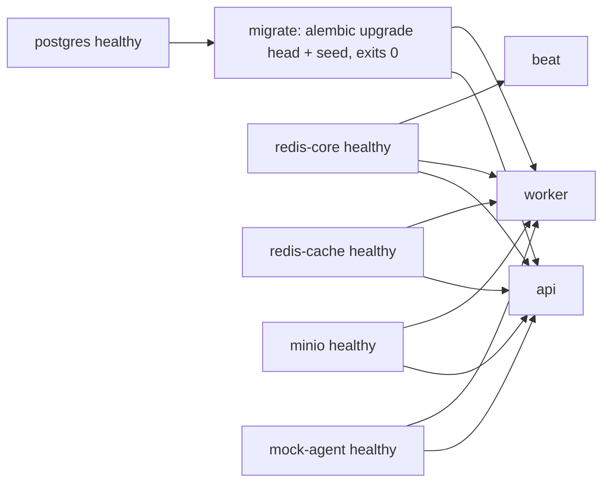

# 10 — Deployment

> Paths are relative to `DL-07-Agentic-AI-System-II/` unless they start with `/` (repo root). There is **no single compose file for the whole system**. Each module has its own stack (`/docker-compose.yml` header: combining them "is still open").

## Compose stacks

| Stack (project name) | File | Services |
|---|---|---|
| `teamd-shared` | `/docker-compose.yml` | `keycloak` |
| `tsa-backend` | `02_api_backend/docker-compose.yml` | `api`, `worker`, `beat`, `migrate`, `mock-agent`, `postgres`, `redis-core`, `redis-cache`, `minio`, `jaeger` (profile `observability`) |
| `tsa-backend` + Keycloak override | `02_api_backend/docker-compose.keycloak.yml` | empties dev JWT key, points `JWKS_URL` at Keycloak via `host.docker.internal` |
| agent | `03_travel_ai_agent/compose.yaml` | `travel-agent` (bundles 04/05/06 code), `decision-engine` |
| `teamd-07` | `07_decision_llm_engine/compose.yaml` | `decision-engine` |
| 08 | `08_recommendation_feedback/docker-compose.yml` | `app`, `postgres:16-alpine`, `redis:7-alpine` |
| `tsa-webapp` | `01_web_app/docker-compose.yml` | `web` (dev), `web-prod` (profile `prod`) |

## Ports (host → container)

| Service | Host | Container | Bind | File |
|---|---|---|---|---|
| keycloak | `KC_HOST_PORT` (8180) | 8080 | 127.0.0.1 | `/docker-compose.yml` |
| api | `API_HOST_PORT` (8000) | 8000 | all | `02_api_backend/docker-compose.yml` |
| mock-agent | `MOCK_AGENT_HOST_PORT` (8010) | 8010 | all | same |
| postgres | `POSTGRES_HOST_PORT` (5432) | 5432 | all | same |
| redis-core / redis-cache | 6379 / 6380 | 6379 | all | same |
| minio / console | 9000 / 9001 | 9000 / 9001 | all | same |
| jaeger UI | 16686 | 16686 | all | same |
| worker metrics | not published | 9101 | backend network | same |
| travel-agent | `AGENT_HOST_PORT` (8010) | 8010 | 127.0.0.1 | `03_travel_ai_agent/compose.yaml` |
| decision-engine | `DECISION_HOST_PORT` (8050) | 8050 | 127.0.0.1 | `07_decision_llm_engine/compose.yaml:6-7` |
| 08 app | 8080 | 8080 | all | `08_recommendation_feedback/docker-compose.yml:4-5` |
| web | `WEB_HOST_PORT` (3000) | 3000 | all | `01_web_app/docker-compose.yml` |

Note: mock-agent (02 stack) and travel-agent (03 stack) both default to host port 8010, so only one can run at a time.

## Volumes

| Volume | Used by | Purpose |
|---|---|---|
| `keycloak-data` + `./identity/keycloak` (ro import) | keycloak | realm import (first start only) |
| `pgdata` | postgres | database |
| `redis-core-data` | redis-core | AOF persistence |
| (none) | redis-cache | cache is disposable |
| `minio-data` | minio | export files |
| `./app:/app/app:ro` bind | api, worker, beat, migrate | hot reload in dev |
| `decision-audit` | decision-engine | `/app/data/audit.jsonl` |
| anonymous `/app/node_modules`, `/app/.next` | web | keep Linux deps over host bind mount |

## Health checks

| Service | Check | File |
|---|---|---|
| api | python `urllib` GET `/health` (liveness only, by design) | `02_api_backend/docker-compose.yml`, `app/api/ops.py:55` |
| worker | `celery inspect ping -d celery@$HOSTNAME` | same |
| beat | schedule file non-empty | same |
| mock-agent | GET `/health` | same |
| postgres | `pg_isready` | same |
| redis-* | `redis-cli ping` | same |
| minio | `mc ready local` | same |
| keycloak | raw TCP HTTP request to management port 9000 `/health/ready` (image has no curl) | `/docker-compose.yml` |
| decision-engine | `/health` | `07_decision_llm_engine/compose.yaml:33` |
| web runtime | `node -e fetch('/api/health')` | `01_web_app/Dockerfile` |
| Readiness | `GET /ready` checks DB + redis-core (fatal), redis-cache + Agent (reported) | `02_api_backend/README.md` |

## Startup order (02 stack)

`depends_on` with `service_healthy` / `service_completed_successfully` in `02_api_backend/docker-compose.yml`. `docker compose up -d --build --wait` waits for health. 03 waits on `decision-engine: service_healthy` (`03_travel_ai_agent/compose.yaml`).

## Dockerfiles

| Image | Stages | Notes | File |
|---|---|---|---|
| 02 backend | `base` → `deps` → `dev` / `runtime` | python:3.12-slim, `apt-get upgrade`, non-root `app`, uv from `ghcr.io/astral-sh/uv:0.12.15`, `uv sync --frozen --no-dev --no-install-project` with cache mount, runtime runs `python -m app.serve --workers 2`, `PROMETHEUS_MULTIPROC_DIR` | `02_api_backend/Dockerfile` |
| 03 agent | `runtime` target, build context `..` so sibling modules can be copied in | `03_travel_ai_agent/Dockerfile`, `compose.yaml` |
| 07 decision | uv frozen sync, non-root, `/health` healthcheck, writes only to audit volume + tmp | `07_decision_llm_engine/Dockerfile`, `README.md` |
| 01 web | `base` → `deps` → `dev` / `builder` → `runner` (standalone, non-root `nextjs`) | `01_web_app/Dockerfile` |
| Hardening (03/07 compose) | `read_only: true`, `tmpfs: /tmp`, `cap_drop: ALL`, `no-new-privileges` | `03_travel_ai_agent/compose.yaml` |

## Seed scripts

| Script | What | Idempotent | File |
|---|---|---|---|
| `scripts/seed_reference_data.py` | Coverage area (placeholder Thailand bounding polygon) + emergency default instructions per region/language | Yes, `INSERT … ON CONFLICT DO UPDATE` by PK | `02_api_backend/scripts/seed_reference_data.py:13`, `app/infrastructure/db/reference_data.py:1-30`, `:92-125` |
| `scripts/dev_token.py` | Issue dev HS256 JWT with scopes | n/a | `02_api_backend/scripts/dev_token.py` |
| `scripts/export_openapi.py` | Write `openapi.json` | n/a | `02_api_backend/scripts/export_openapi.py` |
| `scripts/refresh_examples.py` | Rewrite example timestamps for demos (mock data only) | n/a | `07_decision_llm_engine/scripts/refresh_examples.py` |
| `scripts/smoke_http.py` | HTTP smoke test of 07 | n/a | `07_decision_llm_engine/scripts/smoke_http.py` |
| 08 schema | `db_schema.sql` via `docker-entrypoint-initdb.d` | first start only | `08_recommendation_feedback/db_schema.sql:1-3` |
| Vector index seed | Not found in code | — | — |

## Make targets (02)

`make up | down | logs | migrate | downgrade | revision | token | scenario | seed | test | test-e2e | test-fast | cov | lint | format | typecheck | openapi | check` (`02_api_backend/Makefile`, table in `02_api_backend/README.md`).
